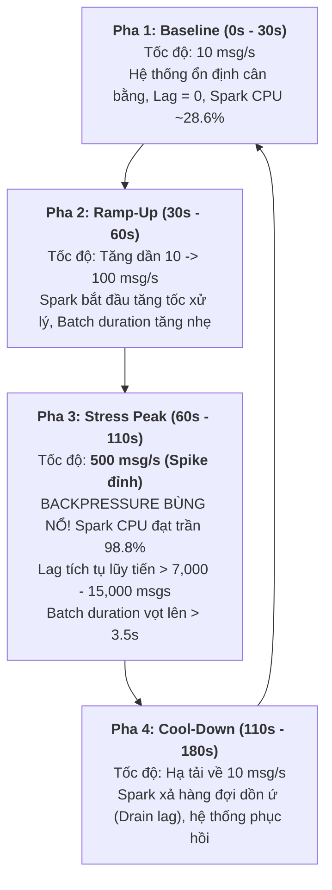

# Hướng Dẫn Thực Nghiệm & Đo Tải (Benchmark Guide) — `benchmarks/`

Thư mục `benchmarks/` được thiết kế để chứa các kịch bản đo đạc hiệu năng tự động hóa (**Automated Performance & Benchmarking Scripts**) của dự án **Cloud Stream IoT**, tập trung vào việc đánh giá khả năng mở rộng phân vùng Kafka, độ nhạy của cơ chế Watermark và đo lường ngưỡng bão hòa áp lực ngược (Backpressure).

---

## 1. Hiện Trạng Các Kịch Bản Trong `benchmarks/`

> [!WARNING]
> **Thông báo kiểm toán hiện trạng:**
> Hai kịch bản shell script trong thư mục `benchmarks/` hiện tại ở trạng thái **[PLACEHOLDER]** (chỉ chứa dòng chú thích khởi tạo, chưa có mã logic thực thi tự động):
> - [`run_partition_test.sh`](./run_partition_test.sh): Khung sườn kịch bản đo khả năng mở rộng theo partition.
> - [`run_watermark_test.sh`](./run_watermark_test.sh): Khung sườn kịch bản đo độ nhạy của các giá trị watermark.
>
> Để thực hiện các bài đo đạc định lượng thực tế, nhóm nghiên cứu sử dụng bộ công cụ thực nghiệm chuyên sâu được cài đặt trong thư mục `NhutTan/src/`.

---

## 2. Mô Hình Ép Tải 4 Pha Khoa Học (4-Phase Stress Test Model)

Bài đo ép tải và xác định điểm nghẽn được triển khai tại [`NhutTan/src/stress_test_backpressure.py`](../NhutTan/src/stress_test_backpressure.py) áp dụng mô hình chu kỳ **180 giây** chia làm 4 giai đoạn chuẩn hóa:



### Các chỉ số then chốt cần quan sát trong từng pha:
1. **Thông lượng vào vs Thông lượng ra (Input Rate vs Processed Rate)**: Khoảnh khắc `Input Rate > Processed Rate` đánh dấu thời điểm hệ thống bắt đầu quá tải.
2. **Thời gian vi mô batch (Micro-Batch Duration)**: Khi thời gian thực thi một batch vượt quá ngưỡng trigger interval ($1.0$ giây), Spark Structured Streaming không thể duy trì tốc độ thời gian thực.
3. **Consumer Group Lag**: Lượng thông điệp dồn ứ tại commit log của Redpanda tăng tuyến tính theo công thức:
   $$\text{Lag}(t) = \int (\text{Input Rate} - \text{Processed Rate}) \, dt$$
4. **Mức sử dụng CPU của Spark (`spark-processor`)**: Chạm trần $98.7\%$ chứng minh CPU tính toán và chi phí giải mã chuỗi JSON là **Điểm Nghẽn Cổ Chai Chính (Primary Bottleneck)**.

---

## 3. Hướng Dẫn Thực Thi Các Kịch Bản Đo Đạc

Để thực hiện bài đo ép tải và xuất báo cáo kết quả:

### Bước 1: Kích hoạt kịch bản ép tải
Chạy từ thư mục gốc của dự án:
```powershell
python .\NhutTan\src\stress_test_backpressure.py --rate 500 --duration 180
```
- `--rate`: Tốc độ phát đỉnh lúc ép tải (mặc định: 500 msg/s).
- `--duration`: Tổng thời gian của kịch bản (mặc định: 180 giây).

### Bước 2: Ghi nhận số liệu baseline (Tùy chọn)
```powershell
python .\NhutTan\src\record_baseline.py
```

### Bước 3: Tạo biểu đồ phân tích điểm nghẽn
```powershell
python .\NhutTan\src\generate_bottleneck_chart.py
```

---

## 4. Định Dạng Kết Quả Xuất Bản (Telemetry Output Format)

Toàn bộ kết quả thực nghiệm sau khi chạy sẽ được lưu trữ tự động trong thư mục `NhutTan/ket_qua/`:

```text
NhutTan/ket_qua/
├── stress_test_metrics.csv                 # Dữ liệu chuỗi thời gian chi tiết từng giây
├── stress_test_metrics.json                # Báo cáo tổng hợp JSON và mẫu các mốc thời gian
├── ket_qua_tuan5_ep_tai_backpressure.txt   # Báo cáo nghiệm thu định dạng văn bản
└── bottleneck_analysis.png                 # Biểu đồ phân tích tương quan Throughput - Lag - CPU
```

### 4.1. Cấu trúc tệp CSV Timeline (`stress_test_metrics.csv`):
Bao gồm các cột số liệu đo đạc theo từng giây:
- `second`: Giây thứ $t$ trong kịch bản ($0 \rightarrow 179$).
- `stage`: Tên giai đoạn (`BASELINE`, `RAMP_UP`, `STRESS_PEAK`, `COOL_DOWN`).
- `input_rate_msg_s`: Tốc độ phát sinh sự kiện từ Generator.
- `processed_rate_rows_s`: Tốc độ tiêu thụ và tính toán thực tế của Spark.
- `consumer_lag`: Số lượng thông điệp ứ đọng tại broker.
- `batch_duration_s`: Thời gian hoàn thành một micro-batch tính bằng giây.
- `checkpoint_duration_s`: Thời gian ghi trạng thái checkpoint.
- `is_backpressure`: Cờ boolean đánh dấu trạng thái áp lực ngược.
- `spark_cpu_percent`: Tỷ lệ phần trăm CPU tiêu thụ của Spark container.
- `redpanda_cpu_percent`: Tỷ lệ phần trăm CPU tiêu thụ của Redpanda container.
- `spark_memory_mb`: Bộ nhớ RAM working set của Spark container.

### 4.2. Cấu trúc tệp JSON Tổng Hợp (`stress_test_metrics.json`):
Chứa khối `summary` với các chỉ số thống kê cực trị:
```json
{
  "summary": {
    "test_name": "Spark Structured Streaming Multi-Stage Stress Test",
    "total_duration_seconds": 180,
    "peak_input_rate": 500,
    "spark_max_throughput_capacity": 200,
    "max_consumer_lag_observed": 15000,
    "max_batch_duration_seconds": 3.85,
    "bottleneck_first_detected_at_second": 60,
    "primary_bottleneck_component": "spark-processor (CPU Compute & JSON Deserialization Saturation ~98.8%)",
    "secondary_impact": "redpanda (Queue buffer accumulation & Consumer Lag build-up)",
    "end_to_end_latency_peak_seconds": 78.85
  }
}
```

---

## 5. Kế Hoạch Hiện Thực Hóa Hai Script Shell (Future Benchmark Implementations)

Để chuyển hai tệp placeholder thành kịch bản thực thi hoàn chỉnh trong giai đoạn tiếp theo của đề tài:

1. **`run_partition_test.sh`**:
   - Sử dụng lệnh `rpk topic create iot-sensor-events -p $PARTITIONS` để tăng số lượng partition lần lượt thành 1, 3, 5.
   - Sử dụng `event_producer.py` bơm tải cố định 100 msg/s trong 5 phút.
   - Truy vấn API Redpanda Prometheus để ghi lại throughput và trích xuất mức tải CPU từng core từ cAdvisor.
2. **`run_watermark_test.sh`**:
   - Gọi lệnh khởi chạy `late_data_router.py` với tham số `--watermark-delay` lần lượt là `"30 seconds"`, `"60 seconds"`, `"120 seconds"`, `"300 seconds"`.
   - Kết thúc mỗi đợt chạy, kích hoạt `batch_evaluator.py` để đếm chính xác số lượng bản ghi rơi vào `late_data.jsonl` và `accepted_events.jsonl`, tự động tính toán tỷ lệ loại bỏ dữ liệu.

