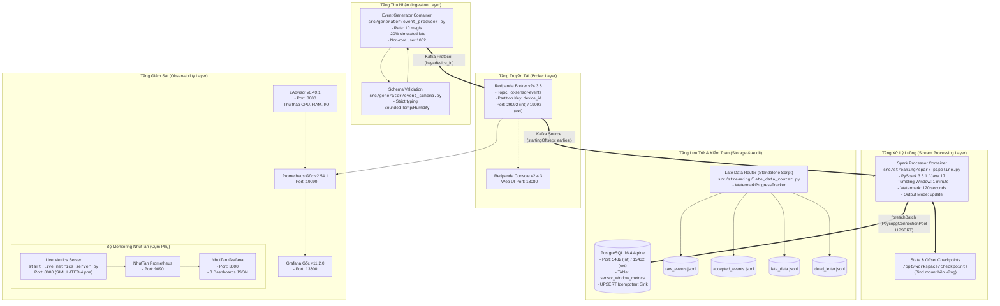
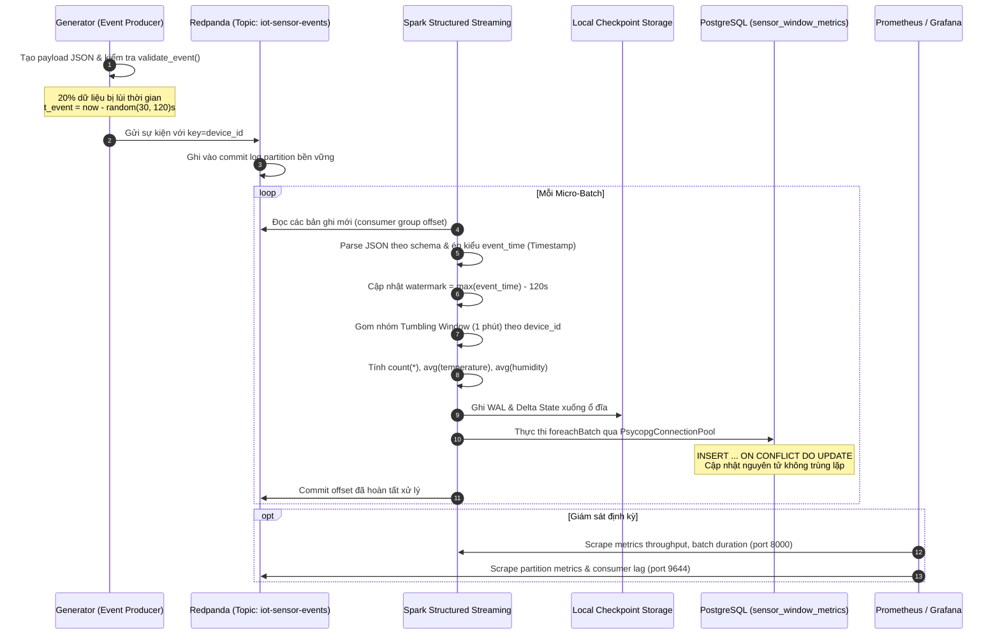
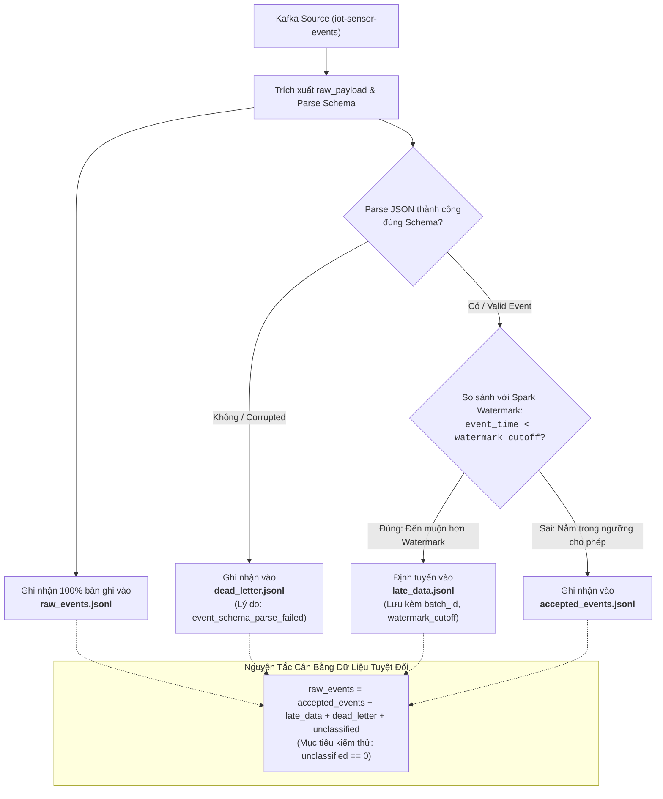
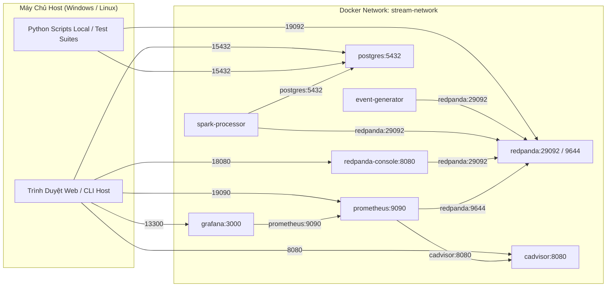

# Chuyên Đề 02: Kiến Trúc Hệ Thống & Luồng Dữ Liệu

## 1. Tổng Quan Kiến Trúc

Hệ thống **Cloud Stream IoT (Đề tài 16)** được thiết kế theo kiến trúc xử lý luồng phân tán (**Distributed Stream Processing Architecture**), tuân thủ nguyên lý phân tách trách nhiệm (**Separation of Concerns**) giữa các tầng:
- **Tầng Thu Nhận & Sinh Dữ Liệu (Ingestion & Generation)**
- **Tầng Đệm Thông Điệp Bền Vững (Message Broker / Streaming Storage)**
- **Tầng Xử Lý Luồng Có Trạng Thái (Stateful Stream Processing)**
- **Tầng Lưu Trữ Đích & Phục Vụ Truy Vấn (Serving & Sink Storage)**
- **Tầng Giám Sát Toàn Diện (Observability & Telemetry)**

Toàn bộ hệ sinh thái được đóng gói thành các dịch vụ container độc lập, kết nối thông qua mạng ảo nội bộ Docker bridge network mang tên `stream-network`.

---

## 2. Kiến Trúc Thực Tế Triển Khai (As-Is Architecture)

Khác với các sơ đồ lý thuyết thông thường, kiến trúc **As-Is** được tổng hợp trực tiếp từ mã nguồn thực thi tại commit hiện tại của repository.



---

## 3. Luồng Dữ Liệu Đầu Cuối (End-to-End Data Flow)

Dữ liệu luân chuyển xuyên suốt hệ thống theo 6 giai đoạn kế tiếp nhau:



### Chi tiết các pha xử lý dữ liệu:
1. **Pha 1 — Phát sinh & Xác thực biên**: 
   - `event_producer.py` tạo sự kiện định kỳ $1/10$ giây.
   - Hàm `validate_event()` đối chiếu nghiêm ngặt với các ràng buộc nghiệp vụ (nhiệt độ $20-85^\circ C$, độ ẩm $30-90\%$, `event_time` có múi giờ ISO-8601 UTC).
   - Sự kiện hợp lệ được gán nhãn `is_late_simulated` (dùng để đối chiếu thống kê) và đưa vào hàng đợi gửi của thư viện `kafka-python`.
2. **Pha 2 — Phân vùng tại Broker**:
   - Redpanda tiếp nhận gói tin qua giao thức Kafka API cổng nội bộ `29092`.
   - Record được băm theo `device_id` và phân bổ vào partition tương ứng, đảm bảo toàn bộ dữ liệu của một thiết bị cảm biến nằm chung partition theo thứ tự ghi nhận.
3. **Pha 3 — Đọc luồng & Áp dụng Watermark**:
   - Engine PySpark kích hoạt micro-batch đọc từ Redpanda với tùy chọn `startingOffsets: earliest`.
   - Spark giải mã chuỗi JSON thành StructType thông qua `build_spark_event_schema()`.
   - Khai báo `.withWatermark("event_time", "120 seconds")` yêu cầu Spark theo dõi giá trị `event_time` lớn nhất và duy trì ngưỡng cắt thời gian $T_{watermark} = \max(event\_time) - 120s$.
4. **Pha 4 — Tổng hợp trạng thái & Ghi nhận Checkpoint**:
   - Spark tổng hợp dữ liệu theo cửa sổ cố định 1 phút: `window(col("event_time"), "1 minute")` và `col("device_id")`.
   - Trước khi phát dữ liệu ra sink, Spark thực hiện ghi nhật ký cam kết (Write-Ahead Log - WAL) và lưu trạng thái state store xuống thư mục checkpoint gắn ngoài `/opt/workspace/checkpoints/spark_pipeline`.
5. **Pha 5 — Ghi cơ sở dữ liệu Idempotent**:
   - `write_batch()` trong hàm `foreachBatch` thu thập các dòng kết quả từ executor, lấy kết nối an toàn từ `PsycopgConnectionPool` và phát lệnh `INSERT ... ON CONFLICT DO UPDATE`.
   - Cơ chế này biến thao tác ghi trở thành thao tác lũy thừa (**Idempotent**), cho phép tái xử lý batch mà không làm sai lệch số liệu.

---

## 4. Cơ Chế Định Tuyến Dữ Liệu Muộn (Late Data Routing Flow)

Bên cạnh luồng xử lý chính ghi vào PostgreSQL, repository cung cấp giải pháp lưu vết kiểm toán toàn diện tại `src/streaming/late_data_router.py`.



### Cơ chế hoạt động của `WatermarkProgressTracker`:
Khác với các cài đặt nghiệp dư tự lấy timestamp cục bộ máy tính làm ngưỡng cắt, `late_data_router.py` triển khai một class `WatermarkProgressTracker` kế thừa từ `StreamingQueryListener` của Apache Spark:
- Lớp này lắng nghe sự kiện `onQueryProgress` do Spark phát ra sau mỗi micro-batch.
- Trích xuất giá trị `event.progress.eventTime.get("watermark")` do chính bộ lập lịch Spark tính toán.
- Chừng nào Spark chưa xác định được watermark chính thức, router không tự ý gán nhãn dữ liệu muộn, ngăn ngừa triệt để lỗi phân loại sai.

---

## 5. Giao Tiếp Mạng Container & Bảng Ánh Xạ Cổng

Toàn bộ các container được kết nối thông qua một mạng ảo người dùng định nghĩa (**User-Defined Bridge Network**) mang tên `stream-network`.



### Bảng Ánh Xạ Cổng và Giao Thức Chi Tiết:

| Dịch Vụ | Tên Container | Cổng Nội Bộ (`stream-network`) | Cổng Host Mapped | Giao Thức / Mục Đích Sử Dụng |
|---|---|:---:|:---:|---|
| **Redpanda Kafka API** | `redpanda` | `29092` | `19092` | Giao thức Kafka nhị phân. Các container dùng `redpanda:29092`, host dùng `localhost:19092`. |
| **Redpanda Admin API** | `redpanda` | `9644` | `19644` | REST API quản trị cluster, kiểm tra healthcheck và cung cấp `/public_metrics` cho Prometheus. |
| **Redpanda Pandaproxy**| `redpanda` | `8082` | `8082` | HTTP REST Proxy truy cập Kafka topic nếu client không có thư viện Kafka gốc. |
| **Redpanda Console**   | `redpanda-console`| `8080` | `18080`| Giao diện Web UI giám sát message, consumer group, schema registry: `http://localhost:18080`. |
| **PostgreSQL**         | `postgres` | `5432` | `15432`| Giao thức PostgreSQL wire protocol. Host kết nối qua port `15432`, Spark qua `postgres:5432`. |
| **cAdvisor**           | `cadvisor` | `8080` | `8080` | Web UI và endpoint metrics `/metrics` cung cấp chỉ số cgroups phần cứng container. |
| **Prometheus Gốc**     | `prometheus` | `9090` | `19090`| Web UI PromQL và API cào số liệu hạ tầng từ cAdvisor và Redpanda. |
| **Grafana Gốc**        | `grafana` | `3000` | `13300`| Web UI bảng điều khiển giám sát hạ tầng. |
| **NhutTan Prometheus** | `nhuttan-prometheus`| `9090`| `9090` | Prometheus phục vụ cụm dashboard chuyên biệt của đề tài (Tuần 1-5). |
| **NhutTan Grafana**    | `nhuttan-grafana`   | `3000`| `3000` | Grafana dựng sẵn 3 dashboard hoàn chỉnh: `http://localhost:3000`. |
| **Live Metrics Server**| Chạy trên Host | `8000` | `8000` | Máy chủ HTTP phát metrics giả lập phục vụ Grafana NhutTan. |

---

## 6. Các Quyết Định Thiết Kế Kiến Trúc (Architecture Decision Records - ADR)

### ADR-01: Lựa chọn Redpanda thay thế Apache Kafka truyền thống
- **Bối cảnh**: Môi trường thực nghiệm cục bộ bị giới hạn tài nguyên phần cứng (RAM < 8 GB). Apache Kafka đòi hỏi cụm Apache ZooKeeper hoặc KRaft controller cồng kềnh tiêu tốn từ 2-4 GB RAM chỉ cho tầng broker.
- **Quyết định**: Sử dụng **Redpanda** (viết bằng C++, tương thích 100% giao thức Kafka API).
- **Hệ quả**: Khởi động tức thì (< 3 giây), kiểm soát tài nguyên chính xác thông qua cờ khởi động `--memory 1G --smp 1`, tiết kiệm RAM tối đa cho tiến trình Spark và Database.

### ADR-02: Lựa chọn Tumbling Window 1 phút và Watermark 120 giây
- **Bối cảnh**: Thiết bị cảm biến phát sinh dữ liệu trễ từ 30 đến 120 giây với xác suất 20%.
- **Quyết định**: Thiết lập cửa sổ cố định không chồng lấn `1 minute` và đặt ngưỡng trễ `watermark_delay: "120 seconds"`.
- **Hệ quả**: Cho phép dung nạp hầu hết các bản ghi bị trễ thông thường trong phạm vi 2 phút. Nếu dữ liệu bị trễ quá 120 giây so với mốc trễ nhất của pipeline, cửa sổ tương ứng đã đóng và dữ liệu đó sẽ bị loại bỏ hoặc chuyển vào tệp log kiểm toán.

### ADR-03: Kỹ thuật Idempotent Upsert cho Tầng Lưu Trữ Đích
- **Bối cảnh**: Spark Structured Streaming hỗ trợ cơ chế lỗi và thử lại (**At-least-once processing**). Khi một batch bị fail giữa chừng hoặc container bị restart, Spark sẽ phát lại toàn bộ bản ghi trong batch đó từ offset gần nhất. Nếu dùng lệnh `INSERT` thông thường, cơ sở dữ liệu sẽ bị lỗi vi phạm khóa chính hoặc nhân đôi bản ghi.
- **Quyết định**: Tạo khóa chính tổng hợp `PRIMARY KEY (window_start, window_end, device_id)` và sử dụng câu lệnh SQL:
  ```sql
  INSERT INTO sensor_window_metrics (window_start, window_end, device_id, event_count, average_temperature, average_humidity)
  VALUES (%s, %s, %s, %s, %s, %s)
  ON CONFLICT (window_start, window_end, device_id)
  DO UPDATE SET
      event_count = EXCLUDED.event_count,
      average_temperature = EXCLUDED.average_temperature,
      average_humidity = EXCLUDED.average_humidity,
      updated_at = CURRENT_TIMESTAMP;
  ```
- **Hệ quả**: Đạt được ngữ nghĩa xử lý tương đương **Effectively Exactly-Once** tại tầng lưu trữ bản ghi, ngăn ngừa triệt để lỗi trùng lặp khi khôi phục sau sự cố.

### ADR-04: Quản lý Kết nối qua Thread-Safe Connection Pool
- **Bối cảnh**: Mở và đóng kết nối TCP tới PostgreSQL liên tục trong hàm `foreachBatch` gây suy giảm hiệu năng nghiêm trọng và nguy cơ tràn socket (Connection Exhaustion).
- **Quyết định**: Đóng gói `PsycopgConnectionPool` sử dụng `psycopg2.pool.ThreadedConnectionPool(minconn=1, maxconn=4)`.
- **Hệ quả**: Tối ưu hóa việc tái sử dụng kết nối, duy trì độ trễ ghi micro-batch ở mức tối thiểu.

---

## 7. Khoảng Thiếu Hụt và Mâu Thuẫn Hiện Tại (Architectural Gaps & Discrepancies)

Trong quá trình rà soát kiến trúc thực tế, một số điểm bất đồng và khoảng trống kỹ thuật cần được ghi nhận minh bạch:

1. **Sự xuất hiện của ClickHouse nhưng không có trong Docker Compose**:
   - Thư mục `volumes/clickhouse` tồn tại trong mã nguồn.
   - Các file script và dashboard giám sát (`NhutTan/src/spark_metrics_listener.py`, `01_container_resources_baseline.json`) có khai báo cấu hình tham chiếu đến container `clickhouse`.
   - **Thực tế**: Tệp `docker-compose.yml` chính **hoàn toàn không định nghĩa dịch vụ ClickHouse**. Do đó, ClickHouse được xếp vào trạng thái **PLANNED / UNVERIFIED** và không thuộc stack đang chạy thực tế.
2. **Sự tồn tại song song của hai hệ thống giám sát**:
   - Stack giám sát gốc trong `docker-compose.yml`: Prometheus (port 19090) + Grafana (port 13300).
   - Stack giám sát mở rộng trong `NhutTan/docker-compose.monitoring.yml`: Prometheus (port 9090) + Grafana (port 3000).
   - **Hệ quả**: Có thể gây nhầm lẫn cổng truy cập cho người vận hành nếu không đọc kỹ tài liệu hướng dẫn.
3. **Phân tách giữa Pipeline chính và Late Data Router**:
   - `spark_pipeline.py` phụ trách luồng nghiệp vụ đẩy vào PostgreSQL.
   - `late_data_router.py` phụ trách luồng kiểm toán ghi vào 4 file JSONL.
   - Hai tiến trình này hiện chạy độc lập chứ chưa được gộp chung thành một pipeline đa sink trong Compose.

