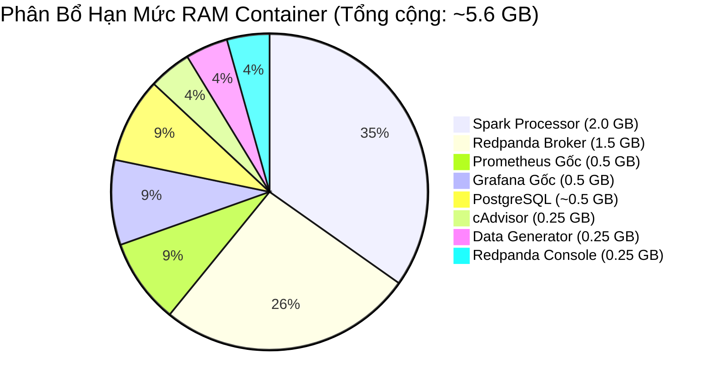

# Chuyên Đề 03: Hạ Tầng Triển Khai & Containerization

## 1. Tổng Quan Hạ Tầng

Hệ thống **Cloud Stream IoT** được thiết kế để triển khai đồng nhất, có khả năng tái lập 100% (**Reproducible Infrastructure**) trên môi trường máy trạm lập trình viên hoặc máy chủ thử nghiệm cục bộ thông qua Docker Compose v2. Toàn bộ các dịch vụ phụ thuộc đều được đóng gói dưới dạng container hóa, loại bỏ hoàn toàn hiện tượng lệch môi trường ("Works on my machine").

---

## 2. Bảng Công Nghệ & Phiên Bản Chi Tiết (Technology Stack)

Tất cả các phiên bản được trích xuất trực tiếp từ `docker-compose.yml`, Dockerfiles và `requirements.txt`:

| Thành Phần / Thư Viện | Phiên Bản Cụ Thể | Base Image / Gốc Phát Hành | Vai Trò Trong Dự Án |
|---|:---:|---|---|
| **Redpanda** | `v24.3.8` | `docker.redpanda.com/redpandadata/redpanda:v24.3.8` | Message Broker phân tán chuẩn Kafka protocol, viết bằng C++ |
| **Redpanda Console** | `v2.4.3` | `docker.redpanda.com/redpandadata/console:v2.4.3` | Giao diện Web UI quản trị Broker, Topic và Consumer Group |
| **PostgreSQL** | `16.4-alpine` | `postgres:16.4-alpine` | Cơ sở dữ liệu quan hệ, tầng lưu trữ đích (Window Metrics Sink) |
| **cAdvisor** | `v0.49.1` | `gcr.io/cadvisor/cadvisor:v0.49.1` | Thu thập chỉ số tài nguyên container (CPU, RAM, Network, FS I/O) |
| **Prometheus Gốc** | `v2.54.1` | `prom/prometheus:v2.54.1` | Hệ thống cơ sở dữ liệu chuỗi thời gian (TSDB) lưu trữ metrics hạ tầng |
| **Grafana Gốc** | `11.2.0` | `grafana/grafana:11.2.0` | Nền tảng trực quan hóa số liệu và quản trị cảnh báo |
| **Python Base** | `3.10-slim` | `python:3.10-slim` (Debian Bookworm) | Base image cho Event Generator và Spark Processor |
| **Java Runtime** | `OpenJDK 17 Headless` | `default-jre-headless` (apt-get) | Môi trường máy ảo Java JVM cho lõi Apache Spark |
| **Apache Spark / PySpark** | `3.5.1` | PyPI: `pyspark==3.5.1` | Động cơ tính toán phân tán Structured Streaming |
| **Kafka Connector JAR** | `3.5.1` (Scala 2.12) | Maven: `spark-sql-kafka-0-10_2.12:3.5.1` | Thư viện tích hợp Spark kết nối tới Redpanda/Kafka |
| **Kafka Python** | `2.0.2` | PyPI: `kafka-python==2.0.2` | Thư viện phát sinh thông điệp Kafka từ Generator |
| **Psycopg2 Binary** | `2.9.9` | PyPI: `psycopg2-binary==2.9.9` | Driver kết nối và Connection Pool tới PostgreSQL |
| **Prometheus Client** | `0.20.0` | PyPI: `prometheus-client==0.20.0` | Thư viện xuất bản chỉ số đo lường qua HTTP endpoint |
| **PyYAML** | `6.0.1` | PyPI: `pyyaml==6.0.1` | Thư viện đọc và nạp cấu hình hệ thống từ file YAML |
| **NumPy & Pandas** | `1.26.4` & `2.2.2` | PyPI | Thư viện hỗ trợ tính toán và phân tích batch dữ liệu |

---

## 3. Đặc Tả Chi Tiết 8 Dịch Vụ Docker Compose

Tệp `docker-compose.yml` tại thư mục gốc định nghĩa 8 dịch vụ:

### 3.1. Dịch vụ `redpanda`
- **Mục đích**: Nhận, phân vùng và lưu trữ bền vững các sự kiện cảm biến IoT.
- **Lệnh thực thi**:
  ```yaml
  command:
    - redpanda
    - start
    - --smp 1
    - --memory 1G
    - --reserve-memory 0M
    - --overprovisioned
    - --node-id 0
    - --check=false
    - --kafka-addr PLAINTEXT://0.0.0.0:29092,OUTSIDE://0.0.0.0:9092
    - --advertise-kafka-addr PLAINTEXT://redpanda:29092,OUTSIDE://localhost:19092
    - --pandaproxy-addr 0.0.0.0:8082
    - --advertise-pandaproxy-addr redpanda:8082
  ```
- **Phân bổ tài nguyên**: CPU tối đa 1.0 Core, RAM giới hạn 1.5 GB.
- **Healthcheck**: `rpk cluster health --api-urls localhost:9644` (chu kỳ 10s, timeout 5s, 12 lần thử).

### 3.2. Dịch vụ `redpanda-console`
- **Mục đích**: Cung cấp giao diện trực quan cho phép duyệt danh sách topic, xem trực tiếp payload từng message và giám sát lag của từng consumer group.
- **Phụ thuộc**: Đợi `redpanda` đạt trạng thái `service_healthy`.
- **Tài nguyên**: 0.5 CPU, 256 MB RAM.

### 3.3. Dịch vụ `postgres`
- **Mục đích**: Lưu trữ kết quả phân tích theo khung thời gian (Tumbling Window) của cảm biến.
- **Biến môi trường**: `POSTGRES_USER`, `POSTGRES_PASSWORD`, `POSTGRES_DB` (bắt buộc nạp từ `.env`).
- **Healthcheck**: `pg_isready -U "$$POSTGRES_USER" -d "$$POSTGRES_DB"` (chu kỳ 10s, timeout 5s, 12 lần thử).
- **Lưu trữ**: Bind mount `./volumes/postgres` vào `/var/lib/postgresql/data`.

### 3.4. Dịch vụ `data-generator` (Container: `event-generator`)
- **Mục đích**: Giả lập phát sự kiện cảm biến IoT liên tục với tốc độ 10 msg/s, xen kẽ 20% dữ liệu trễ 30-120 giây.
- **Bảo mật**: Tiến trình chạy dưới quyền tài khoản non-root `generator` (UID 1002, shell `/bin/false`).
- **Phụ thuộc**: Đợi `redpanda` đạt `service_healthy`.
- **Tài nguyên**: 0.5 CPU, 256 MB RAM.

### 3.5. Dịch vụ `cadvisor`
- **Mục đích**: Giám sát tự động việc sử dụng tài nguyên của toàn bộ các container đang chạy trên host Docker daemon.
- **Mount hệ thống**: Mount read-only `/`, `/var/run`, `/sys`, `/var/lib/docker`.
- **Tài nguyên**: 0.5 CPU, 256 MB RAM.

### 3.6. Dịch vụ `prometheus`
- **Mục đích**: Hệ thống giám sát gốc, định kỳ cào số liệu từ `cadvisor:8080` và `redpanda:9644/public_metrics`.
- **Healthcheck**: `wget --spider -q http://localhost:9090/-/healthy`.
- **Tài nguyên**: 0.5 CPU, 512 MB RAM.

### 3.7. Dịch vụ `grafana`
- **Mục đích**: Bảng điều khiển giám sát gốc, tự động nạp cấu hình provisioning từ `./configs/grafana/provisioning`.
- **Healthcheck**: `wget --spider -q http://localhost:3000/api/health`.
- **Tài nguyên**: 0.5 CPU, 512 MB RAM.

### 3.8. Dịch vụ `stream-processor` (Container: `spark-processor`)
- **Mục đích**: Lõi tính toán PySpark Structured Streaming thực hiện tumbling window, lọc watermark và upsert vào PostgreSQL.
- **Môi trường thực thi**: Debian Slim cài sẵn `default-jre-headless` (Java 17).
- **Bảo mật**: Chạy dưới quyền tài khoản non-root `spark` (UID 1001), sở hữu thư mục `/opt/workspace/checkpoints`.
- **Biến môi trường**: `CHECKPOINT_LOCATION: /opt/workspace/checkpoints/spark_pipeline`, `CHECKPOINT_ROOT: /opt/workspace/checkpoints`.
- **Phụ thuộc**: Đợi cả `redpanda` và `postgres` đạt `service_healthy`.
- **Tài nguyên**: 2.0 Cores CPU, 2.0 GB RAM.

---

## 4. Bảng Ánh Xạ Cổng Đầy Đủ (Port Mapping Table)

| Dịch Vụ Docker | Cổng Host Mapped | Cổng Container | Giao Thức / Mục Đích |
|---|:---:|:---:|---|
| `redpanda` | `19092` | `9092` | Kafka Client kết nối từ máy host |
| `redpanda` | `8082` | `8082` | Redpanda Pandaproxy HTTP REST API |
| `redpanda` | `19644` | `9644` | Redpanda Admin & Prometheus Metrics |
| `redpanda-console` | `18080` | `8080` | Web UI điều khiển: `http://localhost:18080` |
| `postgres` | `15432` | `5432` | PostgreSQL SQL Engine & Integrity Checks |
| `cadvisor` | `8080` | `8080` | Web UI cAdvisor: `http://localhost:8080` |
| `prometheus` (Gốc) | `19090` | `9090` | Web UI Prometheus gốc: `http://localhost:19090` |
| `grafana` (Gốc) | `13300` | `3000` | Web UI Grafana gốc: `http://localhost:13300` |
| `nhuttan-prometheus` | `9090` | `9090` | Prometheus của cụm NhutTan: `http://localhost:9090` |
| `nhuttan-grafana` | `3000` | `3000` | Grafana của cụm NhutTan: `http://localhost:3000` |
| `live_metrics_server` | `8000` | `8000` | HTTP Server phát số liệu giả lập |

---

## 5. Lưu Trữ Bền Vững & Quản Lý Volume (Persistent Volumes)

Dự án ưu tiên sử dụng kỹ thuật **Host Bind Mounts** để toàn bộ dữ liệu trạng thái được lưu trực tiếp trên hệ thống tệp của máy phát triển, thuận tiện cho việc kiểm toán, sao lưu và kiểm tra mã nguồn:

```text
cloud-stream-project/
├── checkpoints/             # Bind mount vào /opt/workspace/checkpoints (State & WAL của Spark)
├── logs/                    # Bind mount vào /app/logs (Log kiểm toán và JSONL router)
├── volumes/
│   ├── redpanda/            # Gắn vào /var/lib/redpanda/data (Commit log phân vùng Kafka)
│   ├── postgres/            # Gắn vào /var/lib/postgresql/data (Data cluster của PostgreSQL 16)
│   ├── prometheus/          # Gắn vào /prometheus (TSDB của Prometheus gốc)
│   ├── grafana/             # Gắn vào /var/lib/grafana (Database nội bộ SQLite của Grafana gốc)
│   └── clickhouse/          # [PLANNED] Thư mục dự phòng cho OLAP sink trong tương lai
```

> [!WARNING]
> Tuyệt đối không thực hiện lệnh `docker compose down --volumes` (hoặc `docker compose down -v`) khi đang tiến hành thí nghiệm đo đạc hoặc diễn tập khôi phục, vì lệnh này sẽ xóa sạch dữ liệu phân vùng và trạng thái checkpoint.

---

## 6. Biến Môi Trường & Quản Trị Bí Mật (.env Configuration)

Mọi bí mật (credentials) và tham số môi trường được tách biệt tuyệt đối khỏi mã nguồn thông qua tệp mẫu `.env.example`:

```env
# PostgreSQL (the pipeline sink)
POSTGRES_USER=admin
POSTGRES_PASSWORD=your_secure_password_here
POSTGRES_DB=app_db

# Grafana
GRAFANA_ADMIN_USER=admin
GRAFANA_ADMIN_PASSWORD=Grafana@2026NewPass
```

### Nguyên tắc bảo mật bắt buộc:
1. Tệp `.env` đã được đưa vào `.gitignore` và tuyệt đối không được commit lên Git.
2. Cú pháp trong `docker-compose.yml` áp dụng quy tắc ép buộc tham số: `${POSTGRES_PASSWORD:?POSTGRES_PASSWORD is required}`. Nếu người dùng khởi chạy mà chưa tạo file `.env`, Docker Compose sẽ dừng ngay lập tức và cảnh báo thiếu biến, ngăn chặn việc khởi chạy với mật khẩu mặc định rỗng.
3. Khi thư mục `volumes/postgres` đã khởi tạo dữ liệu lần đầu, việc đổi mật khẩu trong `.env` sẽ không tự động cập nhật mật khẩu nội bộ PostgreSQL; cần thực thi lệnh đổi mật khẩu bằng câu lệnh SQL bên trong database nếu cần thiết.

---

## 7. Yêu Cầu Cài Đặt Cục Bộ & Chuẩn Bị Môi Trường

### Yêu cầu phần cứng tối thiểu:
- **CPU**: Tối thiểu 4 Cores vật lý (khuyến nghị 8 Cores để chạy mượt mà Spark local và Redpanda).
- **RAM**: Tối thiểu 6 GB RAM khả dụng cho Docker Desktop (khuyến nghị cấp phát 8 GB RAM trong cấu hình Docker Settings -> Resources).
- **Ổ đĩa**: Trống tối thiểu 10 GB SSD để lưu trữ image Docker và các file checkpoint.

### Yêu cầu phần mềm:
- **Hệ điều hành**: Windows 10/11 (với WSL2 backend) hoặc Linux Ubuntu 22.04 LTS / macOS.
- **Docker Engine**: Docker Desktop phiên bản 4.30+ hoặc Docker Engine 26+.
- **Docker Compose**: Compose v2.20+.
- **Python**: Python 3.10+ (kèm môi trường ảo `.venv`) để thực thi các script kiểm thử hoặc live metrics server.

---

## 8. Hướng Dẫn Khởi Động Từng Bước (Step-by-Step Guide)

### Bước 1: Chuẩn bị tệp môi trường
Mở PowerShell tại thư mục gốc của dự án:
```powershell
Set-Location F:\Python\cloud-stream-project
Copy-Item .env.example .env
```
Mở tệp `.env` và thiết lập mật khẩu bảo mật cho `POSTGRES_PASSWORD`.

### Bước 2: Kiểm tra tính hợp lệ của cấu hình
```powershell
docker compose config
```
Lệnh trên phải phân giải đầy đủ các biến môi trường mà không báo lỗi cú pháp.

### Bước 3: Khởi tạo và biên dịch cụm dịch vụ chính
```powershell
docker compose up -d --build
```
Docker sẽ tiến hành build hai image nội bộ (`Dockerfile.generator` và `Dockerfile.spark`), sau đó khởi động đồng loạt 8 container.

### Bước 4: Kiểm tra trạng thái sẵn sàng (Health Checks)
```powershell
docker compose ps
```
Quan sát cột `STATUS`. Hệ thống đạt chuẩn sẵn sàng khi các dịch vụ `redpanda`, `postgres`, `prometheus`, `grafana` đều chuyển sang trạng thái `(healthy)`.

### Bước 5: (Tùy chọn) Khởi chạy bộ giám sát NhutTan phục vụ Demo
Nếu muốn sử dụng 3 Dashboard Grafana chuyên dụng dựng sẵn:
1. Cửa sổ PowerShell 1: Khởi động Live Metrics Server:
   ```powershell
   .\.venv\Scripts\python.exe .\NhutTan\src\start_live_metrics_server.py
   ```
2. Cửa sổ PowerShell 2: Khởi chạy cụm giám sát NhutTan:
   ```powershell
   docker compose -f .\NhutTan\docker-compose.monitoring.yml up -d
   ```
3. Truy cập Grafana NhutTan tại địa chỉ: `http://localhost:3000` (Tài khoản: `admin` / `admin`).

---

## 9. Khắc Phục Sự Cố Thường Gặp (Troubleshooting Runbook)

### Sự cố 1: Topic Kafka gặp lỗi Leaderless Partitions
- **Triệu chứng**: `spark-processor` báo lỗi `org.apache.kafka.common.errors.TimeoutException: Timed out waiting for a node assignment` hoặc `DisconnectException`.
- **Nguyên nhân**: Redpanda bị tắt đột ngột khiến siêu dữ liệu Raft phân vùng chưa kịp đồng thuận leader.
- **Cách khắc phục**:
  ```powershell
  docker exec redpanda rpk cluster health --api-urls localhost:9644
  docker exec redpanda rpk topic describe iot-sensor-events
  ```
  Nếu topic mất leader, có thể xóa và tái tạo nhanh bằng:
  ```powershell
  docker exec redpanda rpk topic delete iot-sensor-events
  docker exec redpanda rpk topic create iot-sensor-events --partitions 3
  ```

### Sự cố 2: Spark Container báo lỗi quyền ghi Checkpoint (Permission Denied)
- **Triệu chứng**: Tiến trình Spark bị crash với lỗi `java.io.IOException: Permission denied` tại đường dẫn `/opt/workspace/checkpoints/spark_pipeline`.
- **Nguyên nhân**: Container Spark chạy dưới quyền non-root `spark` (UID 1001), trong khi thư mục `checkpoints` trên host Windows/Linux được tạo bởi người dùng quyền khác.
- **Cách khắc phục**: Đảm bảo cấp quyền ghi cho toàn bộ thư mục `./checkpoints`:
  ```powershell
  docker exec -u 0 spark-processor chown -R spark:spark /opt/workspace/checkpoints
  ```

### Sự cố 3: Xung đột cổng kết nối (Port Conflict)
- **Triệu chứng**: Khởi chạy Docker Compose thất bại với thông báo `Bind for 0.0.0.0:8080 failed: port is already allocated`.
- **Nguyên nhân**: Cổng `8080` (cAdvisor/Redpanda Console) hoặc `9090` (Prometheus) bị ứng dụng khác trên máy host (như IIS, Tomcat, Jenkins) chiếm dụng.
- **Cách khắc phục**: Kiểm tra tiến trình đang giữ cổng và dừng lại:
  ```powershell
  Get-NetTCPConnection -LocalPort 8080 | Format-Table OwningProcess
  Stop-Process -Id <PID> -Force
  ```

---

## 10. Giới Hạn Tài Nguyên Container (cgroups Limits)

Bảng tổng hợp cấu hình tài nguyên quy định trong `docker-compose.yml`:



Mục đích của việc ép hạn mức CPU (`cpus: "1.0"` cho Redpanda và `cpus: "2.0"` cho Spark) là tạo ra một môi trường có thể tái hiện chính xác hiện tượng bão hòa năng lực tính toán và xuất hiện áp lực ngược khi tăng tốc độ phát sự kiện.

---

## 11. So Sánh Mô Hình Triển Khai: Local Docker vs Cloud-Native

| Tiêu Chí So Sánh | Môi Trường Thực Nghiệm (Local Docker) | Mô Hình Mở Rộng Cloud-Native (Khuyến Nghị Tương Lai) |
|---|---|---|
| **Cơ Chế Điều Phối** | Docker Compose v2 (Single Host) | Kubernetes (EKS / GKE / AKS) sử dụng Helm Charts |
| **Message Broker** | Redpanda Single Node Container | Cụm Kafka đa node phân tán trên 3 Availability Zones |
| **Động Cơ Spark** | PySpark chạy chế độ `local[2]` trong 1 container | Spark on K8s (1 Spark Driver Pod + $N$ Spark Executor Pods) |
| **Lưu Trữ Checkpoint** | Local Bind Mount (`./checkpoints`) | Cloud Object Storage bền vững 99.999999999% (AWS S3, Google Cloud Storage) |
| **Tầng Lưu Trữ Đích** | PostgreSQL Single Container | Amazon Aurora PostgreSQL Multi-AZ hoặc Cụm ClickHouse Cloud OLAP |
| **Giám Sát & Cảnh Báo** | Prometheus + cAdvisor container cục bộ | Managed Prometheus / Datadog / OpenTelemetry Collector |
| **Ước Tính Chi Phí** | **0 VNĐ** (Chạy trên máy tính sẵn có) | Dự kiến \$300 - \$800/tháng phụ thuộc vào lưu lượng và tài nguyên VM |

