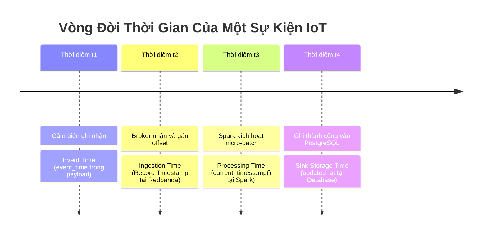
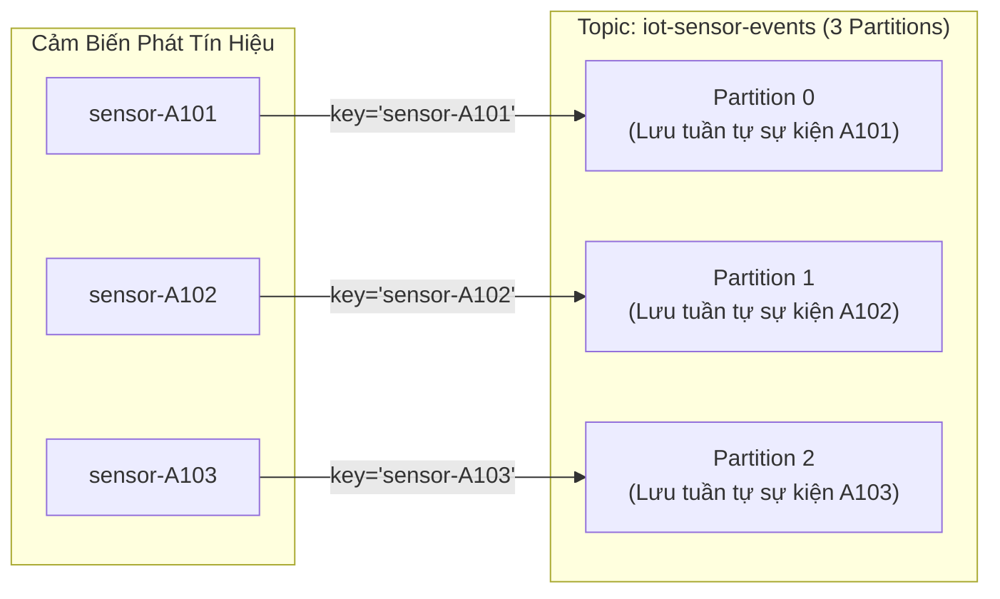

# Chuyên Đề 04: Mô Hình Dữ Liệu & Hợp Đồng Sự Kiện

## 1. Tổng Quan Nguồn Dữ Liệu IoT

Trong kiến trúc của đề tài, nguồn phát dữ liệu mô phỏng một mạng lưới gồm 5 thiết bị cảm biến công nghiệp (`sensor-A101` đến `sensor-A105`). Các cảm biến này đo lường liên tục các thông số môi trường vật lý quan trọng: **nhiệt độ** ($^\circ C$) và **độ ẩm tương đối** ($\%$) tại các vị trí nhà xưởng hoặc trạm quan trắc.

Mọi sự kiện phát sinh đều được cấu trúc dưới định dạng chuẩn **JSON (JavaScript Object Notation)** và tuân thủ một hợp đồng dữ liệu nghiêm ngặt (**Data Contract**) trước khi được đẩy vào Message Broker.

---

## 2. Đặc Tả JSON Event Schema

Cấu trúc JSON chuẩn được định nghĩa tại [`src/generator/event_schema.py`](../src/generator/event_schema.py) bao gồm đúng 6 trường bắt buộc:

```json
{
  "device_id": "sensor-A101",
  "event_time": "2026-11-04T14:00:10+00:00",
  "temperature": 24.85,
  "humidity": 58.42,
  "status": "OK",
  "is_late_simulated": false
}
```

### Bảng Định Nghĩa Chi Tiết Từng Trường (Field Specification):

| Tên Trường | Kiểu Dữ Liệu | Ràng Buộc Giá Trị | Ví Dụ Mẫu | Ý Nghĩa Nghiệp Vụ |
|---|:---:|---|:---:|---|
| `device_id` | `string` | Không rỗng, độ dài $\le 100$ ký tự | `"sensor-A101"` | Mã định danh duy nhất của thiết bị cảm biến |
| `event_time` | `string` | Chuẩn ISO-8601, **bắt buộc có timezone UTC** | `"2026-11-04T14:00:10+00:00"` | Mốc thời gian cảm biến thực hiện đo lường |
| `temperature` | `float` | Số hữu hạn, thuộc đoạn $[20.0, 85.0]$ | `24.85` | Giá trị nhiệt độ đo được (độ C) |
| `humidity` | `float` | Số hữu hạn, thuộc đoạn $[30.0, 90.0]$ | `58.42` | Giá trị độ ẩm tương đối đo được (%) |
| `status` | `string` | Chỉ chấp nhận một trong hai: `'OK'`, `'CRITICAL'` | `"OK"` | Trạng thái tự chẩn đoán của thiết bị |
| `is_late_simulated` | `boolean` | `true` hoặc `false` | `false` | Cờ nhãn phục vụ kiểm chứng thực nghiệm |

---

## 3. Phân Biệt Ba Loại Mốc Thời Gian (Event Time, Ingestion Time, Processing Time)

Xử lý luồng phân tán bắt buộc phải phân định rạch ròi 3 khái niệm thời gian:



1. **Event Time (Thời gian sự kiện)**: 
   - Là thời điểm sự kiện thực sự diễn ra trên thế giới thực, do đồng hồ phần cứng của cảm biến ghi lại (`event_time`).
   - Đây là **căn cứ duy nhất** được Spark sử dụng để gom nhóm vào các cửa sổ Tumbling Window và tính toán độ dịch chuyển của Watermark.
2. **Ingestion Time (Thời gian nạp)**:
   - Là thời điểm thông điệp chạm tới broker Redpanda và được ghi vào commit log của partition.
3. **Processing Time (Thời gian xử lý)**:
   - Là thời điểm máy ảo Spark Executor thực sự quét qua và tính toán bản ghi trong một micro-batch.

### Tác động của mạng truyền thông:
Khi đường truyền bị chậm hoặc mất kết nối:
$$\text{Event Time} \ll \text{Ingestion Time} \le \text{Processing Time}$$
Khoảng chênh lệch $\Delta t = \text{Ingestion Time} - \text{Event Time}$ chính là **độ trễ dữ liệu đến muộn (Late Data Delay)**.

---

## 4. Logic Sinh Dữ Liệu & Cơ Chế Giả Lập Dữ Liệu Muộn

Hàm `generate_sensor_event()` tại [`src/generator/event_producer.py`](../src/generator/event_producer.py) thực thi quy trình toán học sau:

```python
def generate_sensor_event(devices, late_per, min_delay, max_delay):
    device_id = random.choice(devices)
    now = datetime.now(timezone.utc)

    is_late = random.random() < late_per
    if is_late:
        delay_sec = random.randint(min_delay, max_delay)
        event_time = now - timedelta(seconds=delay_sec)
    else:
        event_time = now

    event = {
        "device_id": device_id,
        "event_time": event_time.isoformat(timespec="seconds"),
        "temperature": round(random.uniform(20.0, 85.0), 2),
        "humidity": round(random.uniform(30.0, 90.0), 2),
        "status": "CRITICAL" if random.random() < 0.05 else "OK",
        "is_late_simulated": is_late,
    }
    validate_event(event)
    return device_id, event
```

### Nguyên lý thống kê:
- Tỷ lệ dữ liệu trễ mặc định: `late_data_percent: 0.20` ($20\%$).
- Độ trễ phân bổ ngẫu nhiên đều (Uniform Distribution): $T_{delay} \in [30, 120]$ giây.
- Tỷ lệ trạng thái lỗi `CRITICAL`: Ngẫu nhiên $5\%$ (mô phỏng sự cố cảm biến đột xuất).

> [!IMPORTANT]
> **Ý nghĩa của trường `is_late_simulated`:**
> `is_late_simulated` **hoàn toàn là một nhãn kiểm chứng mặt đất (Ground Truth Label)** do tầng sinh dữ liệu gắn vào để phục vụ việc đánh giá, kiểm thử thống kê đối chiếu. **Pipeline Spark Structured Streaming tuyệt đối không sử dụng trường này để đưa ra quyết định chấp nhận hay loại bỏ dữ liệu!** Quyết định của Spark chỉ dựa trên giá trị của trường `event_time` so với giá trị nội tại của Watermark tại thời điểm thực thi.

---

## 5. Chiến Lược Topic, Khóa & Phân Vùng Kafka (Partition Strategy)

- **Tên Topic**: `iot-sensor-events`
- **Khóa Phân Vùng (Partition Key)**: Giá trị chuỗi `device_id` (ví dụ: `"sensor-A101"`).
- **Thuật toán phân phối**:
  $$\text{Partition Index} = \text{murmur2}(\text{device\_id}) \pmod{\text{Total Partitions}}$$



### Lợi ích kỹ thuật của việc phân vùng theo `device_id`:
1. **Bảo toàn thứ tự thời gian cục bộ (Per-device Total Ordering)**: Kafka chỉ đảm bảo tính thứ tự trên từng partition. Bằng cách gán `key=device_id`, mọi gói tin của cùng một cảm biến luôn rơi vào cùng một partition và được tiêu thụ theo đúng trình tự đến broker.
2. **Khả năng mở rộng xử lý song song (Horizontal Scalability)**: Spark có thể kích hoạt số lượng partition task tương ứng với số phân vùng của topic để đọc dữ liệu đồng thời mà không lo tranh chấp.

---

## 6. Quy Tắc Xác Thực Dữ Liệu (Schema Validation Rules)

Hàm `validate_event(event)` triển khai cơ chế kiểm tra phòng vệ đa lớp:

1. **Kiểm tra đầy đủ trường (Completeness Check)**:
   - Tập hợp các trường trong payload phải trùng khít 100% với `REQUIRED_EVENT_FIELDS`.
   - Bất kỳ trường nào bị thiếu hoặc bất kỳ trường dư thừa nào (Unrecognized / Extra fields) đều kích hoạt ngoại lệ `EventValidationError`.
2. **Kiểm tra kiểu dữ liệu & Độ rỗng**:
   - `device_id` bắt buộc là chuỗi ký tự khác rỗng (loại bỏ chuỗi chỉ chứa khoảng trắng).
   - `is_late_simulated` bắt buộc là kiểu `bool` chuẩn của Python (từ chối chuỗi `"true"` hoặc số `1`).
3. **Kiểm tra định dạng thời gian có Timezone**:
   - `event_time` phải phân tích được bằng `datetime.fromisoformat()`.
   - Thuộc tính `parsed_event_time.tzinfo` không được phép bằng `None`. Bắt buộc phải có định danh múi giờ (UTC `+00:00` hoặc `Z`), loại trừ rủi ro lệch giờ cục bộ giữa các container.
4. **Kiểm tra miền giá trị vật lý (Domain Bounds Check)**:
   - Nhiệt độ phải là số thực hữu hạn: $20.0 \le \text{temperature} \le 85.0$.
   - Độ ẩm phải là số thực hữu hạn: $30.0 \le \text{humidity} \le 90.0$.
   - Từ chối triệt để các giá trị vô cực (`Infinity`), `NaN` hoặc giá trị kiểu boolean vô tình truyền vào trường số.

---

## 7. Định Nghĩa Spark SQL Schema & Database DDL

### 7.1. Spark SQL Schema (`build_spark_event_schema`)
Được định nghĩa tương thích hoàn toàn với schema của Generator:

```python
StructType([
    StructField("device_id", StringType(), nullable=False),
    StructField("event_time", StringType(), nullable=False),
    StructField("temperature", DoubleType(), nullable=False),
    StructField("humidity", DoubleType(), nullable=False),
    StructField("status", StringType(), nullable=False),
    StructField("is_late_simulated", BooleanType(), nullable=False),
])
```

### 7.2. PostgreSQL Table Schema (`configs/database_schema.sql`)
Bảng đích lưu trữ kết quả phân tích theo cửa sổ thời gian:

```sql
CREATE TABLE IF NOT EXISTS sensor_window_metrics (
    window_start TIMESTAMPTZ NOT NULL,
    window_end TIMESTAMPTZ NOT NULL,
    device_id VARCHAR(100) NOT NULL,
    event_count BIGINT NOT NULL,
    average_temperature DOUBLE PRECISION,
    average_humidity DOUBLE PRECISION,
    updated_at TIMESTAMPTZ NOT NULL DEFAULT CURRENT_TIMESTAMP,
    PRIMARY KEY (window_start, window_end, device_id)
);
```

### Phân tích thiết kế bảng:
- `window_start` và `window_end` dùng kiểu `TIMESTAMPTZ` (Timestamp with time zone) để lưu trữ chính xác mốc thời gian UTC có múi giờ.
- **Khóa chính tổng hợp (Composite Primary Key)**: `(window_start, window_end, device_id)` đảm bảo mỗi thiết bị chỉ có duy nhất một bản ghi tổng hợp cho một khung thời gian 1 phút xác định.
- `updated_at`: Tự động cập nhật thời điểm micro-batch gần nhất tác động vào dòng, hỗ trợ đo lường độ trễ từ lúc sự kiện xảy ra đến khi được ghi nhận vào cơ sở dữ liệu.

---

## 8. Giới Hạn Của Mô Hình Dữ Liệu Hiện Tại (Schema Evolution Limitations)

1. **Chưa hỗ trợ tiến hóa Schema linh hoạt (No Schema Registry)**:
   - Hệ thống chưa tích hợp Confluent/Redpanda Schema Registry với Avro hoặc Protobuf.
   - Việc kiểm thực schema phụ thuộc vào mã nguồn Python chia sẻ ở cả hai đầu (`event_schema.py`). Nếu generator bổ sung thêm trường mới (ví dụ `battery_level`), tiến trình Spark hiện tại sẽ bỏ qua hoặc từ chối nếu không cập nhật đồng thời.
2. **Chưa có trường định danh duy nhất cho từng sự kiện (`event_id` / UUID)**:
   - Các sự kiện hiện tại chưa có trường `uuid` hoặc chuỗi hash riêng biệt. Việc khử trùng lặp ở tầng sự kiện thô (Raw Event Deduplication) trước khi gom nhóm cửa sổ gặp khó khăn nếu broker bị gửi trùng lặp thông điệp cùng mốc thời gian.
3. **Mô hình dữ liệu tĩnh (Fixed Sensor List)**:
   - Danh sách 5 sensor được hardcode trong `pipeline_config.yaml`. Hệ thống chưa có cơ chế quản lý vòng đời thiết bị (Device Metadata Management / Registry).

