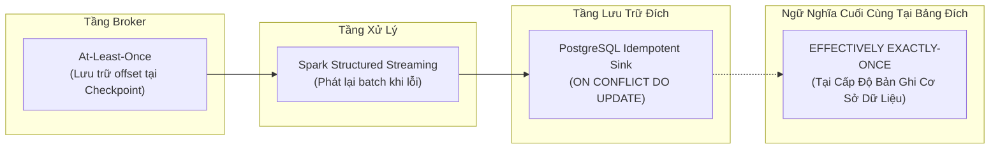
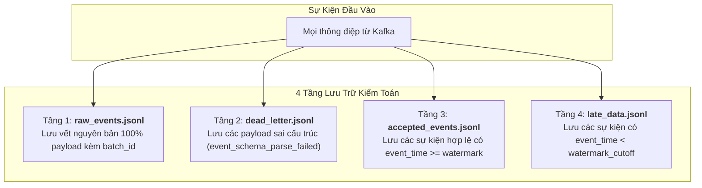

# Chuyên Đề 06: Lưu Trữ Bền Vững & Ngữ Nghĩa Giao Nhận

## 1. Tổng Quan Kiến Trúc Lưu Trữ (Storage Architecture)

Tầng lưu trữ của hệ thống **Cloud Stream IoT** được xây dựng nhằm đáp ứng hai mục tiêu kỹ thuật song hành:
1. **Lưu trữ phục vụ truy vấn nghiệp vụ (Operational OLTP Sink)**: Tiếp nhận các chỉ số tổng hợp theo cửa sổ thời gian thực từ Spark và phục vụ các truy vấn phân tích, kiểm thử toàn vẹn với độ trễ thấp.
2. **Lưu trữ kiểm toán bền vững (Audit Trail Storage)**: Lưu vết đầy đủ 100% sự kiện thô và phân loại chính xác các sự kiện được chấp nhận, dữ liệu đến muộn (Late Data) và dữ liệu hỏng cấu trúc (Dead-Letter) dưới dạng các tệp nhật ký dòng JSONL phân tầng.

---

## 2. Hiện Thực Hóa PostgreSQL Sink & Chiến Lược Idempotency

### 2.1. Cấu Trúc Bảng Dữ Liệu (`sensor_window_metrics`)
Được khởi tạo tự động khi khởi động pipeline thông qua hàm `create_database_table()`:

```sql
CREATE TABLE IF NOT EXISTS sensor_window_metrics (
    window_start TIMESTAMPTZ NOT NULL,
    window_end TIMESTAMPTZ NOT NULL,
    device_id VARCHAR(100) NOT NULL,
    event_count BIGINT NOT NULL,
    average_temperature DOUBLE PRECISION,
    average_humidity DOUBLE PRECISION,
    updated_at TIMESTAMPTZ NOT NULL DEFAULT CURRENT_TIMESTAMP,
    PRIMARY KEY (window_start, window_end, device_id)
);
```

### 2.2. Chiến Lược UPSERT Idempotency (Lũy Thừa Hóa Thao Tác Ghi)
Khái niệm **Idempotent (Tính lũy thừa)** quy định rằng: Một thao tác khi được thực thi nhiều lần với cùng một tham số đầu vào sẽ mang lại kết quả trạng thái hệ thống giống hệt như khi chỉ thực thi một lần duy nhất:

$$f(f(x)) = f(x)$$

Trong Spark Structured Streaming, khi một micro-batch bị gián đoạn giữa chừng do container bị dừng đột ngột hoặc mất kết nối mạng, Spark sẽ kích hoạt cơ chế thử lại (Retry) và phát lại toàn bộ batch từ offset đã ghi nhớ trong checkpoint. Nếu sử dụng lệnh `INSERT` thông thường, hệ thống sẽ gặp lỗi vi phạm ràng buộc khóa chính (`UniqueViolation`).

Dự án giải quyết triệt để vấn đề này bằng câu lệnh SQL UPSERT tối ưu:

```sql
INSERT INTO sensor_window_metrics (
    window_start, window_end, device_id, event_count,
    average_temperature, average_humidity
) VALUES (%s, %s, %s, %s, %s, %s)
ON CONFLICT (window_start, window_end, device_id)
DO UPDATE SET
    event_count = EXCLUDED.event_count,
    average_temperature = EXCLUDED.average_temperature,
    average_humidity = EXCLUDED.average_humidity,
    updated_at = CURRENT_TIMESTAMP;
```

### Phân tích hành vi SQL:
- Khi một khung thời gian của một thiết bị xuất hiện lần đầu tiên: Lệnh `INSERT` thêm một dòng mới vào bảng.
- Khi các bản ghi mới thuộc cùng khung thời gian đó tiếp tục đến trong các micro-batch sau (do chế độ `outputMode("update")`): Mệnh đề `ON CONFLICT` phát hiện trùng lặp khóa chính `(window_start, window_end, device_id)` và tự động chuyển sang nhánh `DO UPDATE`.
- Trường `event_count`, `average_temperature` và `average_humidity` được ghi đè bằng giá trị mới nhất (`EXCLUDED.*`), đồng thời trường `updated_at` ghi nhận chính xác mốc thời gian cập nhật.

---

## 3. Ngữ Nghĩa Giao Nhận Dữ Liệu (Delivery Semantics)

Trong các hệ thống phân tán, việc phân biệt chính xác ngữ nghĩa giao nhận là điều tối quan trọng để đánh giá độ tin cậy.



> [!CAUTION]
> **Tuyên bố khoa học trung thực về ngữ nghĩa giao nhận:**
> Hệ thống **KHÔNG ĐẠT ĐƯỢC chuẩn "End-to-End Exactly-Once thuần túy" (Pure Two-Phase Commit E2E Exactly-Once)** trên toàn tuyến, vì không có giao thức 2PC phân tán giữa Spark và PostgreSQL. 
> 
> Thay vào đó, hệ thống kết hợp giữa:
> 1. **Ngữ nghĩa At-Least-Once** từ nguồn Kafka và cơ chế replay của Spark Checkpoint;
> 2. **Cơ chế Idempotent Sink** tại tầng PostgreSQL thông qua khóa chính tổng hợp và câu lệnh `ON CONFLICT DO UPDATE`.
>
> Sự kết hợp này mang lại kết quả trạng thái cuối cùng đạt **Effectively Exactly-Once (Tương đương đúng-một-lần)** tại cấp độ bản ghi trong cơ sở dữ liệu: dù một batch có bị tính toán và ghi lại 5 lần sau khi khởi động lại, số lượng dòng, giá trị số liệu và trạng thái của bảng `sensor_window_metrics` hoàn toàn không bị sai lệch hay nhân đôi.

---

## 4. Kiểm Tra Trùng Lặp & Tính Toàn Vẹn Dữ Liệu (Integrity Validation)

Để chứng minh tính toàn vẹn và không trùng lặp, kịch bản [`ops/verify_recovery.ps1`](../ops/verify_recovery.ps1) và [`tests/sql/run_integrity_check.py`](../tests/sql/run_integrity_check.py) thực thi các truy vấn kiểm tra logic chặt chẽ:

### 4.1. Kiểm tra không có bản ghi trùng lặp (Duplicate Detection)
```sql
SELECT
    window_start,
    window_end,
    device_id,
    COUNT(*) AS duplicate_count
FROM sensor_window_metrics
GROUP BY window_start, window_end, device_id
HAVING COUNT(*) > 1;
```
- **Tiêu chuẩn đạt (PASS)**: Kết quả trả về phải là **0 dòng**.

### 4.2. Kiểm tra tính hợp lệ của biên cửa sổ (Window Bounds Validity)
```sql
SELECT COUNT(*)
FROM sensor_window_metrics
WHERE window_end <= window_start;
```
- **Tiêu chuẩn đạt (PASS)**: Số lượng dòng vi phạm phải bằng **0**.

### 4.3. Thuật toán Checksum Toàn Bảng (Deterministic Table Checksum)
Để so sánh toàn bộ nội dung dữ liệu trước và sau khi thực hiện diễn tập khôi phục sự cố, hệ thống sử dụng thuật toán băm chuỗi nối deterministic:

```sql
SELECT
    COUNT(*) AS row_count,
    COALESCE(
        md5(
            string_agg(
                concat_ws(
                    '|',
                    window_start::text,
                    window_end::text,
                    device_id,
                    event_count::text,
                    COALESCE(average_temperature::text, ''),
                    COALESCE(average_humidity::text, '')
                ),
                '||' ORDER BY window_start, window_end, device_id
            )
        ),
        md5('')
    ) AS result_checksum
FROM sensor_window_metrics;
```
- Sắp xếp dữ liệu theo `ORDER BY window_start, window_end, device_id`.
- Nối các trường bằng ký tự phân cách `|`.
- Băm toàn bộ tập dữ liệu thành một chuỗi MD5 duy nhất (`result_checksum`).

---

## 5. Hiện Trạng Lưu Trữ ClickHouse: Thư Mục Tồn Tại vs Cấu Hình

Trong cấu trúc thư mục của repository, tồn tại đường dẫn `volumes/clickhouse` và một số chú thích trong mã nguồn đề cập đến việc đẩy dữ liệu vào ClickHouse để phân tích OLAP tốc độ cao.

### Kiểm toán hiện trạng:
- **Tệp `docker-compose.yml` chính**: **HOÀN TOÀN KHÔNG CÓ** định nghĩa service `clickhouse`.
- **Mã nguồn `spark_pipeline.py`**: Chỉ hiện thực hóa sink PostgreSQL qua `PsycopgConnectionPool`, chưa có mã nguồn kết nối ClickHouse.
- **Tập lệnh `NhutTan/src/spark_metrics_listener.py`**: Có một dòng gán thông số baseline cho container `clickhouse` phục vụ việc hiển thị dashboard thử nghiệm.

### Kết luận đánh giá:
Thành phần ClickHouse hiện ở trạng thái **[PLANNED] / [UNVERIFIED]**. Thư mục `volumes/clickhouse` chỉ là placeholder chuẩn bị cho kiến trúc mở rộng trong tương lai và hiện **chưa hoạt động** trong runtime của dự án. Báo cáo kỹ thuật phải nêu rõ điều này để tránh gây hiểu lầm cho người đánh giá.

---

## 6. Kiến Trúc Nhật Ký Kiểm Toán Phân Tầng (4-Layer JSONL Audit Log)

Trong [`src/streaming/late_data_router.py`](../src/streaming/late_data_router.py) và [`src/batch/batch_evaluator.py`](../src/batch/batch_evaluator.py), hệ thống duy trì 4 tệp nhật ký dòng định dạng JSONL (JSON Lines) bền vững:



### Công thức kế toán sự kiện (Event Accounting Invariant):
Module `batch_evaluator.py` thẩm định tính toàn vẹn theo phương trình cân bằng:

$$N_{raw} = N_{accepted} + N_{late} + N_{dead\_letter} + N_{unclassified}$$

- Hệ thống được coi là vận hành chính xác hoàn hảo khi:
  $$N_{unclassified} == 0$$
- Nếu $N_{unclassified} \ne 0$, hệ thống sẽ phát cảnh báo vi phạm kiểm toán, biểu thị việc có dữ liệu bị mất tích hoặc thất thoát trong quá trình định tuyến.

---

## 7. Đánh Đổi Kỹ Thuật (Architecture & Storage Trade-offs)

| Quyết Định Thiết Kế | Lợi Điểm Đạt Được | Đánh Đổi / Chi Phí Chấp Nhận |
|---|---|---|
| **UPSERT Idempotency thay vì INSERT thuần** | Triệt tiêu hoàn toàn rủi ro trùng lặp bản ghi khi Spark restart hoặc retry batch. | Chi phí tính toán tại PostgreSQL cao hơn do phải kiểm tra chỉ mục B-Tree của khóa chính trước khi cập nhật. |
| **Lưu Checkpoint trên Local Bind Mount** | Kiểm toán trực tiếp các tệp `.delta` và `.commit`, không phụ thuộc mạng cloud. | Phụ thuộc vào tốc độ I/O của đĩa cục bộ host; không có tính sẵn sàng cao (High Availability) như S3/GCS. |
| **Output Mode Update thay vì Append** | Giảm thiểu độ trễ quan sát kết quả; dữ liệu được cập nhật liên tục vào database. | Phát sinh nhiều câu lệnh ghi vào PostgreSQL hơn cho cùng một cửa sổ đang mở. |
| **Ghi vết JSONL 4 tầng** | Minh bạch 100% số phận từng bản ghi dữ liệu muộn, phục vụ đối chiếu khoa học. | Tăng dung lượng đĩa ghi log; cần cơ chế dọn dẹp log định kỳ (Log Rotation) trong môi trường production. |

