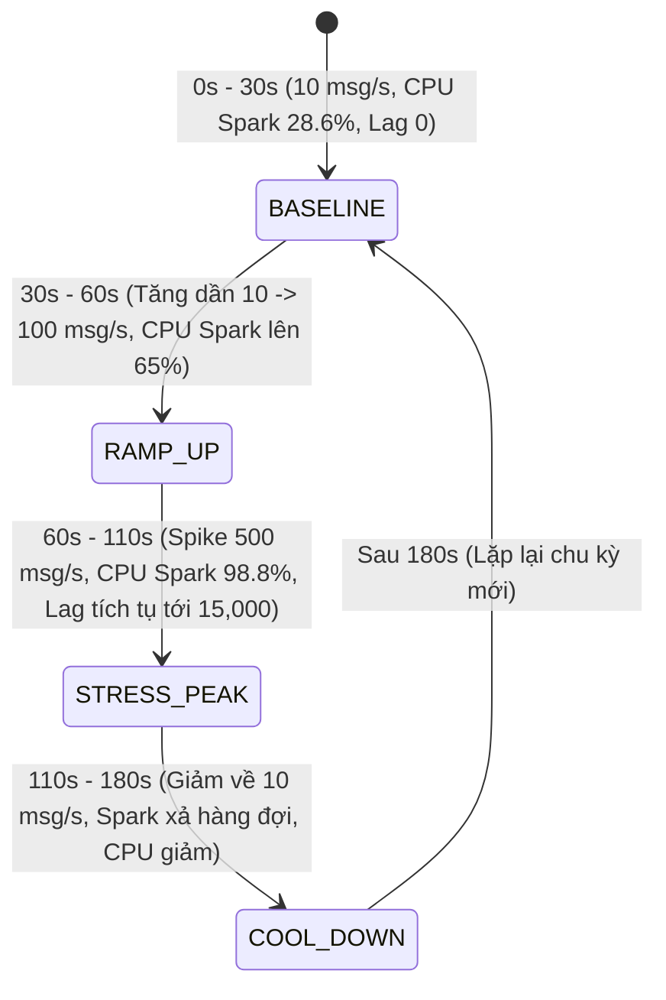
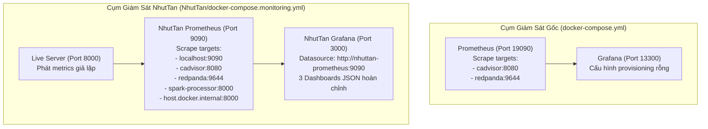

# Chuyên Đề 07: Giám Sát Hệ Thống & Số Liệu Vận Hành

## 1. Mục Tiêu Observability

Hệ thống giám sát và đo lường (Observability) trong dự án **Cloud Stream IoT** được xây dựng nhằm cung cấp cái nhìn định lượng, tức thời và toàn diện về toàn bộ vòng đời của dữ liệu và sức khỏe của các container. Các mục tiêu đo lường cốt lõi bao gồm:
1. **Đo lường Thông Lượng (Throughput In/Out)**: Tốc độ nhận sự kiện từ broker so với tốc độ xử lý của động cơ tính toán Spark.
2. **Theo dõi Dồn Ứ Hàng Đợi (Consumer Lag)**: Phát hiện sớm hiện tượng ứ đọng thông điệp tại các phân vùng Kafka.
3. **Đo lường Độ Trễ Đầu Cuối (End-to-End Latency)**: Thời gian trễ từ khi cảm biến phát sinh sự kiện đến khi kết quả tổng hợp xuất hiện tại cơ sở dữ liệu.
4. **Giám Sát Dữ Liệu Muộn (Late-Data Metrics)**: Đếm số lượng sự kiện bị trôi qua ngưỡng cắt Watermark.
5. **Theo dõi Tài Nguyên Phần Cứng Container**: Giám sát cgroups CPU, RAM working set, Network I/O và Disk I/O thông qua cAdvisor.

---

## 2. Bảng Phân Loại Toàn Diện Các Chỉ Số Đo Lường (Metrics Catalog)

Toàn bộ các metrics trong mã nguồn và dashboard được tổng hợp, phân loại minh bạch theo trạng thái: **IMPLEMENTED** (Đã hiện thực thực tế), **SIMULATED** (Dữ liệu mô phỏng cho demo), hoặc **PROPOSED** (Đề xuất giải pháp kỹ thuật):

| Tên Metric Prometheus | Kiểu | Đơn Vị | Nguồn Thu Thập | Phương Pháp Thu Thập | Trạng Thái |
|---|:---:|:---:|---|---|:---:|
| `spark_streaming_input_rows_per_second` | Gauge | rows/sec | Spark Listener / Live Server | Scrape HTTP `:8000/metrics` | **SIMULATED / PARTIAL** |
| `spark_streaming_processed_rows_per_second`| Gauge | rows/sec | Spark Listener / Live Server | Scrape HTTP `:8000/metrics` | **SIMULATED / PARTIAL** |
| `spark_streaming_batch_duration_seconds` | Gauge | giây | Spark `batchDuration` | Scrape HTTP `:8000/metrics` | **SIMULATED / PARTIAL** |
| `spark_streaming_checkpoint_duration_seconds`| Gauge | giây | Spark `walCommit` + `commitOffsets`| Scrape HTTP `:8000/metrics` | **SIMULATED / PARTIAL** |
| `spark_streaming_consumer_lag` | Gauge | messages | Redpanda Admin / Live Server | Scrape `:9644` hoặc `:8000` | **SIMULATED / PARTIAL** |
| `redpanda_kafka_consumer_group_lag` | Gauge | messages | Redpanda Prometheus metrics | Scrape `redpanda:9644/public_metrics` | **IMPLEMENTED** |
| `spark_streaming_late_events_total` | Counter | events | Router JSONL / Live Server | Tích lũy đếm dữ liệu trễ | **SIMULATED / PARTIAL** |
| `spark_streaming_total_input_rows` | Counter | rows | Spark Listener / Live Server | Tích lũy tổng số bản ghi vào | **SIMULATED / PARTIAL** |
| `container_cpu_usage_seconds_total` | Counter | giây | cAdvisor cgroups | Scrape `cadvisor:8080/metrics` | **IMPLEMENTED** |
| `container_memory_working_set_bytes` | Gauge | bytes | cAdvisor cgroups | Scrape `cadvisor:8080/metrics` | **IMPLEMENTED** |
| `container_network_receive_bytes_total` | Counter | bytes | cAdvisor cgroups | Scrape `cadvisor:8080/metrics` | **IMPLEMENTED** |
| `container_network_transmit_bytes_total`| Counter | bytes | cAdvisor cgroups | Scrape `cadvisor:8080/metrics` | **IMPLEMENTED** |
| `container_fs_writes_bytes_total` | Counter | bytes | cAdvisor cgroups | Scrape `cadvisor:8080/metrics` | **IMPLEMENTED** |
| `spark_streaming_end_to_end_latency_seconds`| Histogram | giây | Đo `updated_at - window_end` | Tính toán truy vấn SQL | **PROPOSED** |

---

## 3. Cảnh Báo Khoa Học Về `start_live_metrics_server.py` (Simulated Metrics)

Trong mã nguồn thư mục [`NhutTan/src/start_live_metrics_server.py`](../NhutTan/src/start_live_metrics_server.py), tồn tại một máy chủ HTTP mini chạy trên cổng 8000. Máy chủ này được lập trình để liên tục phát ra chuỗi số liệu Prometheus mô phỏng theo **chu kỳ lặp lại 180 giây** gồm 4 pha:



> [!WARNING]
> **Quy định đạo đức học thuật & kỹ thuật:**
> Số liệu phát ra từ `start_live_metrics_server.py` là **SỐ LIỆU MÔ PHỎNG THEO CÔNG THỨC TOÁN HỌC (SYNTHETIC / SIMULATED DATA)**, được thiết kế nhằm mục đích kiểm tra khả năng hiển thị giao diện của Grafana trong các bài thuyết trình demo. 
> 
> Báo cáo khoa học và tài liệu kỹ thuật **TUYỆT ĐỐI KHÔNG ĐƯỢC CÔNG NHẬN** các con số này là kết quả đo lường trực tiếp từ tiến trình container `spark-processor`, trừ khi kết quả đó được đối chiếu với log đo đạc thực tế từ cAdvisor và Redpanda.

---

## 4. Đo Lường Độ Trễ Đầu Cuối (End-to-End Latency Measurement)

Độ trễ đầu cuối ($L_{E2E}$) là chỉ số quan trọng bậc nhất của một hệ thống Stream Processing. Nó được định nghĩa là khoảng thời gian từ khi sự kiện được cảm biến đo đạc đến khi kết quả tổng hợp của cửa sổ chứa sự kiện đó được ghi nhận thành công vào cơ sở dữ liệu:

$$L_{E2E} = t_{\text{database\_write}} - t_{\text{event}}$$

### Phương Pháp Đo Lường Đề Xuất (PROPOSED Measurement Method):
Do bảng `sensor_window_metrics` đã có trường `window_end` và `updated_at`, ta có thể tính toán độ trễ hoàn tất cửa sổ thông qua truy vấn SQL:

```sql
SELECT 
    device_id,
    window_start,
    window_end,
    updated_at,
    EXTRACT(EPOCH FROM (updated_at - window_end)) AS window_completion_delay_seconds
FROM sensor_window_metrics
ORDER BY updated_at DESC
LIMIT 20;
```

- `window_completion_delay_seconds`: Biểu thị số giây kể từ thời điểm cửa sổ đóng theo lý thuyết (`window_end`) cho đến khi micro-batch cuối cùng ghi nhận kết quả vào PostgreSQL. Trong điều kiện bình thường với Watermark 120s, chỉ số này xấp xỉ $120\text{s} + \text{batch\_duration}$.

---

## 5. Hiện Trạng Hai Cụm Giám Sát (Dual Monitoring Stacks)

Hệ thống hiện tại duy trì hai cấu hình giám sát song song:



### So Sánh Hai Cụm Giám Sát:
1. **Cụm Giám Sát Gốc**: 
   - Định nghĩa trong `docker-compose.yml` chính.
   - Prometheus chạy tại `http://localhost:19090`, cào metrics hạ tầng thuần túy từ cAdvisor và Redpanda.
   - Grafana chạy tại `http://localhost:13300`.
2. **Cụm Giám Sát NhutTan**:
   - Định nghĩa trong `NhutTan/docker-compose.monitoring.yml`.
   - Prometheus chạy tại `http://localhost:9090`, được cấu hình để cào thêm endpoint cổng 8000 (`host.docker.internal:8000`).
   - Grafana chạy tại `http://localhost:3000` (User: `admin` / Password: `admin`), tự động nạp 3 dashboard chuyên đề.

---

## 6. Danh Mục 3 Bảng Điều Khiển Grafana (NhutTan Dashboards)

Cụm giám sát NhutTan cung cấp 3 dashboard định dạng JSON tại `NhutTan/grafana/dashboards_json/`:

### 6.1. Dashboard 01: `01_container_resources_baseline.json`
- **Tiêu đề**: *Container Hardware Resources & Baseline Monitoring*
- **Mục đích**: Theo dõi tài nguyên phần cứng của toàn bộ 8 container trong trạng thái vận hành chuẩn (10 msg/s).
- **Các Panel chính**:
  1. *CPU Usage per Container (% Core)*: Biểu đồ đường biểu diễn `rate(container_cpu_usage_seconds_total[30s]) * 100`.
  2. *Memory Working Set (MB / GB)*: Đo lường `container_memory_working_set_bytes` so với giới hạn cgroups.
  3. *Network Ingress / Egress (KB/s)*: `container_network_receive_bytes_total` và `transmit_bytes_total`.
  4. *Disk Write Throughput (KB/s)*: `container_fs_writes_bytes_total` trên các thư mục volume bind-mount.

### 6.2. Dashboard 02: `02_spark_streaming_performance.json`
- **Tiêu đề**: *Spark Structured Streaming Performance & Watermark Analysis*
- **Mục đích**: Phân tích hiệu năng xử lý luồng, thông lượng và hành vi của cửa sổ thời gian.
- **Các Panel chính**:
  1. *Input Rate vs. Processed Rate (rows/sec)*: So sánh tốc độ nạp sự kiện và tốc độ tiêu thụ của Spark.
  2. *Micro-Batch Duration vs. Trigger Interval (seconds)*: Cảnh báo khi thời gian xử lý batch vượt ngưỡng 1.0 giây.
  3. *State Store Checkpoint Commit Duration (seconds)*: Thời gian hoàn tất commit WAL và ghi delta checkpoint.
  4. *Cumulative Late Events Count*: Tích lũy các bản ghi trôi qua ngưỡng Watermark.

### 6.3. Dashboard 03: `03_stress_test_bottleneck_backpressure.json`
- **Tiêu đề**: *Stress Test, Consumer Lag & Backpressure Bottleneck Identification*
- **Mục đích**: Bắt trọn khoảnh khắc hệ thống bão hòa khi ép tải và phát hiện điểm nghẽn cổ chai.
- **Các Panel chính**:
  1. *Consumer Group Lag Accumulation*: Số lượng thông điệp dồn ứ trên các partition của `iot-sensor-events`.
  2. *Backpressure Indicator Status*: Cảnh báo chuyển đỏ khi `Input Rate > Processed Rate` kết hợp `Batch Duration > 1.0s`.
  3. *Spark CPU Saturation Bottleneck*: Biểu đồ chứng minh Spark CPU chạm trần 98.8% khi tải tăng lên 500 msg/s.
  4. *Memory Expansion under Heavy Load*: Sự gia tăng của bộ nhớ heap JVM khi lưu đệm dữ liệu dồn dập.

---

## 7. Các Chỉ Số Hoạch Định Nhưng Chưa Hiện Thực (Unimplemented Metrics)

Để hoàn thiện stack observability đạt chuẩn production, các chỉ số sau cần được phát triển trong giai đoạn tiếp theo:
1. **Real-time Spark Native JMX Exporter**: Tích hợp Prometheus JMX Exporter agent trực tiếp vào JVM của Spark Driver và Executor thay vì chạy server giả lập bên ngoài.
2. **Prometheus Alerting Rules**: Định nghĩa tệp luật cảnh báo `alert.rules.yml` cho các điều kiện nguy hiểm:
   - `ConsumerLagAlert`: Khi lag vượt quá 5,000 messages trong hơn 1 phút.
   - `SparkBatchDurationTooHigh`: Khi thời gian micro-batch vượt quá 3 lần trigger interval.
   - `PostgreSQLConnectionPoolExhausted`: Khi số lượng kết nối đang sử dụng chạm trần `maxconn=4`.

