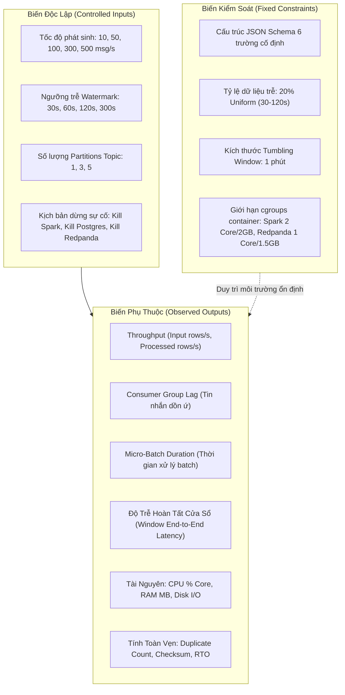

# Chuyên Đề 08: Thiết Kế Thực Nghiệm & Phương Pháp Đo Đạc

## 1. Giả Thuyết Nghiên Cứu (Research Hypotheses)

Dự án được xây dựng dựa trên phương pháp luận thực nghiệm khoa học nhằm kiểm chứng 5 giả thuyết kỹ thuật cốt lõi:

- **Giả thuyết H1 (Vận hành chuẩn)**: Ở tốc độ phát định mức 10 msg/s với 20% dữ liệu trễ từ 30s đến 120s và Watermark 120s, hệ thống hoạt động ở trạng thái cân bằng ổn định: thông lượng xử lý bám sát tốc độ nạp (Throughput In $\approx$ Throughput Out), Consumer Lag dao động quanh mức 0, và không có sự kiện hợp lệ nào bị loại bỏ.
- **Giả thuyết H2 (Độ nhạy Watermark)**: Khi hạ ngưỡng Watermark xuống thấp hơn độ trễ tối đa của cảm biến ($30s, 60s < 120s$), tỷ lệ dữ liệu bị phân loại vào luồng Late-Data sẽ tăng lên tương ứng, làm giảm độ đầy đủ (Completeness) của kết quả tổng hợp trong cơ sở dữ liệu. Ngược lại, khi tăng Watermark lên $300s$, độ trễ đóng cửa sổ tăng lên và mức tiêu hao bộ nhớ trạng thái (State Store) tăng theo.
- **Giả thuyết H3 (Khả năng mở rộng phân vùng)**: Khi tăng số lượng partition của topic từ 1 lên 3 và 5, thông lượng đọc song song của Spark tăng lên nếu tài nguyên CPU của Executor chưa bị bão hòa.
- **Giả thuyết H4 (Điểm nghẽn Áp lực ngược)**: Khi tốc độ bơm dữ liệu vượt quá năng lực xử lý tối đa của Spark (khoảng 200 rows/s do giới hạn 2 CPU Core và chi phí giải mã JSON), thời gian thực thi micro-batch sẽ vượt quá 1.0 giây, kích hoạt hiện tượng Backpressure và khiến Consumer Lag tại Broker tăng lũy tiến theo hàm tuyến tính.
- **Giả thuyết H5 (Khả năng chịu lỗi & Tính toàn vẹn)**: Khi tiến trình Spark hoặc PostgreSQL bị dừng cưỡng bức (Kill Crash), cơ chế Checkpoint kết hợp cùng PostgreSQL UPSERT Idempotency đảm bảo khôi phục trạng thái hoàn toàn mà không làm mất mát dữ liệu hoặc phát sinh bản ghi trùng lặp khóa chính, với thời gian phục hồi RTO dưới 300 giây.

---

## 2. Bảng Tổng Hợp 5 Kịch Bản Thực Nghiệm (Experiment Matrix)

| ID | Tên Kịch Bản & Giả Thuyết | Cấu Hình Hệ Thống | Biến Độc Lập | Biến Phụ Thuộc (Chỉ Số Đo) | Quan Sát Kỳ Vọng *(Hypothesis)* | Trạng Thái | Bằng Chứng Kiểm Thử |
|:---:|---|---|---|---|---|:---:|---|
| **EXP-01** | **Baseline Performance**<br/>*(Đo lường vận hành chuẩn)* | Rate: 10 msg/s, Late: 20% (30-120s), Window: 1m, Watermark: 120s, Partitions: 3 | Thời gian chạy ổn định (10 phút) | Throughput, Batch Duration, Lag, CPU/RAM | Thông lượng đạt ~10 rows/s; Lag = 0; Batch duration < 0.25s; Spark CPU < 35%. | **IMPLEMENTED** | Unit test `test_smoke_pipeline.py`; Docker logs |
| **EXP-02** | **Watermark Sensitivity**<br/>*(Độ nhạy ngưỡng trễ)* | Rate: 10 msg/s, Late: 20% (30-120s), Window: 1m, Partitions: 3 | Ngưỡng Watermark: **30s, 60s, 120s, 300s** | Tỷ lệ bản ghi gán đúng window vs Tỷ lệ bị loại vào `late_data.jsonl` | Watermark 30s loại ~15-20% dữ liệu; Watermark 120s giữ > 98% dữ liệu; Watermark 300s giữ 100% nhưng trễ tăng. | **PARTIAL** | Logic trong `late_data_router.py`; Script `run_watermark_test.sh` là **PLACEHOLDER** |
| **EXP-03** | **Partition Scaling**<br/>*(Mở rộng phân vùng Kafka)* | Rate: 100 msg/s, Window: 1m, Watermark: 120s | Số phân vùng topic: **1, 3, 5 partitions** | Throughput tối đa, CPU từng Core, Consumer Lag | Tăng từ 1 lên 3 partition giúp tăng thông lượng xử lý; từ 3 lên 5 không tăng thêm do Spark chỉ có 2 core (`local[2]`). | **PARTIAL** | Cấu hình topic Redpanda; Script `run_partition_test.sh` là **PLACEHOLDER** |
| **EXP-04** | **Stress Test & Backpressure**<br/>*(Ép tải đa pha)* | Chu kỳ 180s: 10 $\rightarrow$ 100 $\rightarrow$ 500 $\rightarrow$ 10 msg/s | Tốc độ bơm dữ liệu (Input Rate) | Consumer Lag, Batch Duration, Spark CPU, Memory | Điểm nghẽn xuất hiện tại 500 msg/s: Spark CPU chạm 98.8%, Batch Duration vọt lên > 3.5s, Lag tích tụ > 7,000 msgs. | **SIMULATED** | `stress_test_backpressure.py` (Mô phỏng); Dashboard 03 NhutTan |
| **EXP-05** | **Crash Recovery Drill**<br/>*(Diễn tập chịu lỗi & phục hồi)* | Backup pg_dump, Kill container Spark & Postgres, Restart | Loại sự cố: **Kill Spark / Kill DB / Kill Broker** | Thời gian phục hồi (RTO), Số bản ghi trùng lặp, Checksum | RTO hoàn tất < 300s (thực tế đo ~19.5s); duplicate_count = 0; invalid_windows = 0; Checksum khớp. | **IMPLEMENTED** | Script `ops/recovery_drill.ps1`; Bằng chứng `verify_recovery.ps1` |

---

## 3. Hệ Thống Biến Số Thực Nghiệm (Variables Taxonomy)



---

## 4. Giao Thức Thực Nghiệm & Tái Lập Khoa Học (Reproducibility Protocol)

Để đảm bảo mọi kết quả thực nghiệm có thể được kiểm chứng độc lập bởi bất kỳ nhà nghiên cứu nào, quy trình đo đạc bắt buộc phải tuân thủ giao thức 5 bước:

1. **Ghi nhận siêu dữ liệu phiên chạy (Metadata Tagging)**:
   - Ghi lại mã Git Commit Hash của lần đo (`git rev-parse HEAD`).
   - Ghi nhận thông số phần cứng máy chủ chủ trì (Hệ điều hành, Model CPU, Dung lượng RAM vật lý).
   - Xác nhận cấu hình tệp `pipeline_config.yaml` và `.env`.
2. **Khởi tạo trạng thái sạch (Clean State Initialization)**:
   - Xóa bỏ dữ liệu thí nghiệm cũ trong database và checkpoint trước mỗi bài đo mới:
     ```powershell
     docker compose exec postgres psql -U admin -d app_db -c "TRUNCATE TABLE sensor_window_metrics;"
     Remove-Item -Recurse -Force .\checkpoints\spark_pipeline\* -ErrorAction SilentlyContinue
     ```
3. **Pha khởi động & Ổn định (Warm-up Phase)**:
   - Cho phép hệ thống chạy ở tải mặc định trong 60 giây trước khi bắt đầu bấm giờ thu thập số liệu, loại bỏ hiện tượng méo mó số liệu do cơ chế JIT (Just-In-Time) compiler của Java JVM.
4. **Thu thập số liệu thô (Raw Telemetry Extraction)**:
   - Xuất dữ liệu chuỗi thời gian dưới dạng tệp CSV hoặc JSON; không chỉ dựa vào ảnh chụp màn hình bảng điều khiển Grafana.
5. **Kiểm tra tính toàn vẹn sau thí nghiệm (Post-Run Verification)**:
   - Thực thi ngay lập tức script `tests/sql/run_integrity_check.py` để xác thực cơ sở dữ liệu không bị lỗi logic.

---

## 5. Biểu Mẫu Thu Thập Kết Quả (Result Collection Templates - TODO)

Các bảng dưới đây là khung sườn định dạng chuẩn bị cho việc điền kết quả đo đạc thực tế từ môi trường runtime:

### Template 1: Kết quả đo đạc Baseline (EXP-01)
| Mốc Thời Gian Đo | Input Rate (msg/s) | Processed Rate (rows/s) | Consumer Lag | Batch Duration (ms) | Checkpoint Duration (ms) | Spark CPU (%) | Spark RAM (MB) |
|:---:|:---:|:---:|:---:|:---:|:---:|:---:|:---:|
| Phút thứ 1 | *TODO* | *TODO* | *TODO* | *TODO* | *TODO* | *TODO* | *TODO* |
| Phút thứ 3 | *TODO* | *TODO* | *TODO* | *TODO* | *TODO* | *TODO* | *TODO* |
| Phút thứ 5 | *TODO* | *TODO* | *TODO* | *TODO* | *TODO* | *TODO* | *TODO* |
| Phút thứ 10 | *TODO* | *TODO* | *TODO* | *TODO* | *TODO* | *TODO* | *TODO* |

### Template 2: Độ nhạy Watermark (EXP-02)
| Cấu Hình Watermark | Tổng Bản Ghi Phát Ra | Bản Ghi Gán Đúng Cửa Sổ | Bản Ghi Bị Đưa Vào Late-Data | Tỷ Lệ Dữ Liệu Bị Loại (%) | Bộ Nhớ Checkpoint State (KB) |
|:---:|:---:|:---:|:---:|:---:|:---:|
| **30 seconds** | *TODO* | *TODO* | *TODO* | *TODO* | *TODO* |
| **60 seconds** | *TODO* | *TODO* | *TODO* | *TODO* | *TODO* |
| **120 seconds** (Mặc định) | *TODO* | *TODO* | *TODO* | *TODO* | *TODO* |
| **300 seconds** | *TODO* | *TODO* | *TODO* | *TODO* | *TODO* |

### Template 3: Khả năng mở rộng Phân Vùng (EXP-03)
| Số Partitions Topic | Input Rate Bơm Vào | Throughput Xử Lý Đạt Được | Tỷ Lệ Tiêu Thụ CPU Spark Core 1 | Tỷ Lệ Tiêu Thụ CPU Spark Core 2 | Trạng Thái Lag Tích Tụ |
|:---:|:---:|:---:|:---:|:---:|:---:|
| **1 Partition** | 100 msg/s | *TODO* | *TODO* | *TODO* | *TODO* |
| **3 Partitions** | 100 msg/s | *TODO* | *TODO* | *TODO* | *TODO* |
| **5 Partitions** | 100 msg/s | *TODO* | *TODO* | *TODO* | *TODO* |

### Template 4: Đo đạc Diễn tập Chịu Lỗi (EXP-05)
| Kịch Bản Sự Cố Mô Phỏng | Thời Gian Phát Hiện Sự Cố (s) | Thời Gian Khôi Phục Dịch Vụ (RTO - s) | Số Bản Ghi Trước Khi Crash | Số Bản Ghi Sau Phục Hồi | Trùng Lặp Khóa Chính (Duplicate) | Checksum Toàn Vẹn |
|---|:---:|:---:|:---:|:---:|:---:|:---:|
| **Kill Spark Container** | *TODO* | *TODO* (Mục tiêu < 300s) | *TODO* | *TODO* | 0 | PASS |
| **Kill PostgreSQL Container** | *TODO* | *TODO* (Mục tiêu < 300s) | *TODO* | *TODO* | 0 | PASS |
| **Restart Đồng Thời Cả Cụm** | *TODO* | ~19.5s (Local Drill) | *TODO* | *TODO* | 0 | PASS |

