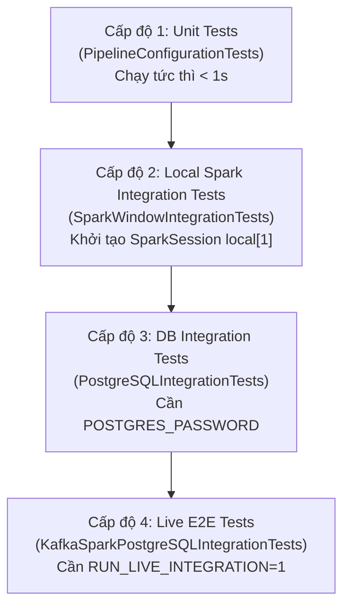

# Chuyên Đề 09: Chiến Lược Kiểm Thử & Xác Thực Toàn Vẹn

## 1. Tổng Quan Chiến Lược Kiểm Thử

Dự án **Cloud Stream IoT** áp dụng mô hình Kim Tự Tháp Kiểm Thử (**Testing Pyramid**) gồm 4 cấp độ chặt chẽ:
1. **Kiểm thử đơn vị (Unit Tests)**: Kiểm tra độc lập các quy tắc cấu hình, phân tích cú pháp thời gian, xác thực hợp đồng schema và phân bổ thống kê.
2. **Kiểm thử tích hợp Spark cục bộ (Local Spark Integration Tests)**: Khởi tạo phiên Spark in-memory độc lập, nạp DataFrame và kiểm tra logic cửa sổ Tumbling Window, Watermark mà không phụ thuộc vào hạ tầng Docker bên ngoài.
3. **Kiểm thử tích hợp Cơ sở dữ liệu (Database Integration Tests)**: Thẩm định khả năng thực thi câu lệnh SQL UPSERT và cơ chế Connection Pool với cơ sở dữ liệu thật.
4. **Kiểm thử đầu cuối hệ thống sống (Live E2E Integration Tests)**: Bơm sự kiện thật qua Kafka, chờ Spark đóng cửa sổ bằng Watermark và đối chiếu dữ liệu ghi nhận tại PostgreSQL.
5. **Kiểm tra toàn vẹn định kỳ (SQL & Batch Integrity Verification)**: Đảm bảo không trùng lặp khóa chính, không có cửa sổ ngược và cân bằng tuyệt đối số lượng sự kiện.



---

## 2. Chi Tiết Các Bộ Kiểm Thử Trong `tests/test_smoke_pipeline.py`

Tệp [`tests/test_smoke_pipeline.py`](../tests/test_smoke_pipeline.py) định nghĩa 4 lớp kiểm thử với danh mục phương thức cụ thể:

### 2.1. Lớp `PipelineConfigurationTests` (Kiểm thử đơn vị cấu hình & Schema)
Chạy hoàn toàn độc lập, không yêu cầu dịch vụ nền:

| Tên Phương Thức Test | Mục Đích Xác Thực | Kết Quả Kỳ Vọng |
|---|---|---|
| `test_runtime_dependencies_are_installed` | Kiểm tra các thư viện lõi `kafka`, `psycopg2`, `pyspark` đã cài đặt đúng phiên bản. | Không gặp `ImportError`. |
| `test_config_uses_container_endpoints_and_postgres_sink` | Kiểm tra hàm `load_config()` nạp đúng broker `redpanda:29092`, bảng `sensor_window_metrics` và mật khẩu môi trường. | Khớp các giá trị cấu hình mặc định. |
| `test_generator_emits_timezone_aware_timestamp` | Kiểm tra sự kiện do generator phát ra có mốc thời gian ISO-8601 kèm múi giờ UTC (`tzinfo == timezone.utc`). | Không được là naive datetime (không múi giờ). |
| `test_event_schema_accepts_generated_event` | Kiểm tra một sự kiện tạo ra hợp lệ vượt qua hàm `validate_event()`. | Không phát sinh ngoại lệ. |
| `test_event_schema_rejects_invalid_payload` | Cố tình truyền payload sai (nhiệt độ $100^\circ C$, status `"UNKNOWN"`, `is_late_simulated` dạng chuỗi) để kiểm tra phòng vệ. | Bắt buộc ném ra ngoại lệ `EventValidationError`. |
| `test_generator_late_data_ratio_is_statistically_close_to_20_percent` | Sinh mẫu lớn ($10,000$ sự kiện) với seed cố định `20261104`, tính toán tỷ lệ `is_late_simulated == true`. | Tỷ lệ thực tế phải nằm trong khoảng $[18\%, 22\%]$. |
| `test_watermark_duration_parser_supports_seconds_and_minutes` | Kiểm tra hàm chuyển đổi chuỗi `duration_to_seconds("120 seconds")` và `("2 minutes")`. | Trả về chính xác số nguyên $120$. |
| `test_checkpoint_path_uses_persistent_mount` | Kiểm tra hàm `resolve_checkpoint_path()` khi có biến môi trường `CHECKPOINT_ROOT`. | Phân giải chính xác đường dẫn bền vững `/opt/workspace/checkpoints/spark_pipeline`. |

### 2.2. Lớp `SparkWindowIntegrationTests` (Kiểm thử tích hợp Spark Window)
Khởi tạo phiên Spark in-memory `local[1]` độc lập:

| Tên Phương Thức Test | Kỹ Thuật Kiểm Thử & Luồng Dữ Liệu | Tiêu Chí Nghiệm Thu |
|---|---|---|
| `test_real_events_are_windowed_by_device_for_one_minute` | Tạo 4 sự kiện JSON mẫu của 2 thiết bị (`sensor-A101`, `sensor-A102`) trải dài qua 2 phút. Thực thi `build_windowed_events()`. | Trả về đúng 3 dòng kết quả. Độ rộng cửa sổ đúng 60 giây. Cửa sổ 1 của A101 có 2 event, avg_temp = 25.0, avg_hum = 50.0. Cửa sổ 2 có 1 event. Sensor A102 được nhóm riêng biệt. |
| `test_watermark_routes_only_events_older_than_cutoff` | Tạo 2 sự kiện với mốc thời gian trước và sau `watermark_cutoff` (14:01:00). Gọi hàm `route_late_events()`. | Chỉ duy nhất 1 bản ghi cũ hơn cutoff bị định tuyến vào `late-data.jsonl`, bản ghi mới được giữ lại. |
| `test_raw_and_dead_letter_storage_preserve_input_records` | Kiểm tra các hàm `append_jsonl()`, `raw_event_record()` và `dead_letter_record()`. | Tệp JSONL được ghi chính xác, bảo toàn nguyên vẹn trường `reason: event_schema_parse_failed`. |
| `test_input_accounting_has_no_unclassified_records` | Kiểm tra phương trình kế toán dữ liệu: 3 sự kiện vào `raw.jsonl` tương ứng với 1 accepted + 1 late + 1 dead-letter. | Tổng số dòng đầu ra bằng chính xác tổng số dòng đầu vào ($3 == 3$). |
| `test_watermark_drops_event_arriving_after_window_is_closed` | Dùng socket source và memory sink của Spark Structured Streaming, đẩy từng micro-batch thực, nâng watermark lên trước, sau đó gửi một event có `event_time` cũ hơn watermark. *(Bỏ qua trên Windows do thiếu Hadoop native)*. | Sự kiện đến sau khi cửa sổ đã đóng không làm tăng số đếm của cửa sổ đó. |

### 2.3. Lớp `PostgreSQLIntegrationTests` (Kiểm thử tích hợp Database)
- **Điều kiện kích hoạt**: Kiểm tra sự tồn tại của biến môi trường `POSTGRES_PASSWORD` và khả năng kết nối tới cổng `15432`. Nếu cơ sở dữ liệu chưa sẵn sàng, bài test sẽ tự động bỏ qua (`self.skipTest`).
- **Phương thức**: `test_write_batch_inserts_and_upserts_real_row()`
  - Thực thi tạo bảng tự động qua `create_database_table()`.
  - Ghi batch 1 với 1 bản ghi (`event_count = 1, avg_temp = 21.5`).
  - Ghi batch 2 với cùng khóa chính `(window_start, window_end, device_id)` nhưng dữ liệu mới (`event_count = 3, avg_temp = 30.0`).
  - Truy vấn lại database để xác nhận kết quả đã được cập nhật (`DO UPDATE`) thành công mà không báo lỗi trùng lặp.
  - Tự động xóa dữ liệu thử nghiệm trong khối `finally`.

### 2.4. Lớp `KafkaSparkPostgreSQLIntegrationTests` (Kiểm thử toàn tuyến Live E2E)
- **Điều kiện kích hoạt**: Yêu cầu người dùng chủ động đặt biến môi trường `$env:RUN_LIVE_INTEGRATION = "1"` và toàn bộ cụm Docker Compose đang chạy.
- **Phương thức**: `test_event_flows_from_kafka_through_spark_to_postgresql()`
  - Tạo một thiết bị ngẫu nhiên duy nhất: `integration-<UUID>`.
  - Sử dụng `KafkaProducer` gửi 3 sự kiện thật vào Redpanda cách nhau 120 giây (tại các mốc 0s, 120s, 240s) để đẩy Watermark tiến về phía trước và đóng cửa sổ đầu tiên.
  - Vòng lặp chờ tối đa 90 giây (`deadline = monotonic() + 90`) để Spark xử lý qua Kafka, tính toán cửa sổ và ghi vào PostgreSQL.
  - Xác nhận dòng dữ liệu xuất hiện trong `sensor_window_metrics` với giá trị mong đợi `(1, 20.0)`.
  - Dọn dẹp dòng dữ liệu thử nghiệm sau khi hoàn tất.

---

## 3. Kiểm Tra Tính Toàn Vẹn Bằng SQL (`tests/sql/run_integrity_check.py`)

Kịch bản Python độc lập thực thi 3 câu lệnh kiểm tra logic toàn vẹn dữ liệu:

```python
CHECKS = (
    ("required_key_columns_are_not_null", """
        SELECT COUNT(*) FROM sensor_window_metrics
        WHERE window_start IS NULL OR window_end IS NULL OR device_id IS NULL
    """),
    ("window_bounds_are_valid", """
        SELECT COUNT(*) FROM sensor_window_metrics
        WHERE window_end <= window_start
    """),
    ("duplicate_logical_rows", """
        SELECT COUNT(*) FROM (
            SELECT window_start, window_end, device_id
            FROM sensor_window_metrics
            GROUP BY window_start, window_end, device_id
            HAVING COUNT(*) > 1
        ) duplicates
    """),
)
```

- Kịch bản đồng thời tính toán mã băm tổng hợp `result_checksum` trên toàn bảng.
- **Tiêu chuẩn đạt**: Cả 3 bài kiểm tra đều trả về `PASS (0 vi phạm)`. Trả về exit code `0` khi thành công và `1` khi phát hiện bất kỳ dòng dữ liệu nào sai phạm.

---

## 4. Đánh Giá Hậu Thực Nghiệm (`src/batch/batch_evaluator.py`)

Sau khi kết thúc mỗi đợt chạy thí nghiệm đo đạc, script `batch_evaluator.py` được thực thi để xuất báo cáo tổng hợp:

1. **Window Record Count**: Báo cáo tổng số dòng đang có trong `sensor_window_metrics`.
2. **Duplicate Window Check**: Rà soát lại toàn bộ khóa chính xem có hiện tượng trùng lặp logic hay không.
3. **Window Statistics**: Thống kê số lượng cảm biến duy nhất (`distinct_devices`), số bản ghi nhỏ nhất/lớn nhất/trung bình trong một cửa sổ (`avg_event_count`), mốc cửa sổ sớm nhất và muộn nhất.
4. **Late Data Accounting**: Đọc và đếm số dòng thực tế trong 4 tệp JSONL (`raw_events.jsonl`, `accepted_events.jsonl`, `late_data.jsonl`, `dead_letter.jsonl`), tính toán số lượng `unclassified`. Nếu $unclassified \ne 0$, in cảnh báo thất thoát dữ liệu.

---

## 5. Tiêu Chí Nghiệm Thu (Pass/Fail Acceptance Criteria)

| Hạng Mục Kiểm Thử | Điều Kiện Đạt (PASS) | Điều Kiện Không Đạt (FAIL) |
|---|---|---|
| **Smoke Unit Tests** | 100% test cases trong `PipelineConfigurationTests` trả về `OK`. | Có ít nhất 1 test case báo `FAIL` hoặc `ERROR`. |
| **Spark Window Tests** | Logic gom nhóm 1 phút, chia theo thiết bị và tính trung bình khớp 100%. | Kết quả tính toán sai lệch giá trị hoặc sai số lượng dòng. |
| **SQL Integrity Checks** | `invalid_rows == 0`, `invalid_windows == 0`, `duplicate_count == 0`. | Có bất kỳ dòng nào bị NULL khóa chính, ngược thời gian hoặc trùng lặp. |
| **Event Balance Check** | `unclassified == 0` trong báo cáo của `batch_evaluator.py`. | Xuất hiện sự chênh lệch giữa số dòng raw và tổng các tầng log. |
| **Disaster Recovery Drill** | Tổng thời gian phục hồi RTO $< 300$ giây, snapshot trước/sau không giảm dòng. | Quá trình vượt quá 5 phút hoặc số lượng bản ghi bị giảm sút. |

---

## 6. Khoảng Trống Kiểm Thử (Test Coverage Gaps)

Mặc dù hệ thống kiểm thử hiện tại đã bao phủ chặt chẽ tầng logic nghiệp vụ, một số khoảng trống vẫn cần được bổ sung:
1. **Kiểm thử chịu tải tự động (Automated Load Testing)**: Hiện chưa có bài test tự động hóa tăng dần tải trong CI/CD pipeline để xác định điểm gãy (Breaking Point).
2. **Kiểm thử phân vùng mạng (Network Partition Testing / Chaos Mesh)**: Chưa có bài kiểm thử tự động mô phỏng việc ngắt kết nối mạng giữa Spark và Redpanda trong 30 giây rồi tự động tái lập kết nối.
3. **Kiểm thử tự động trên môi trường Windows**: Bài test micro-batch streaming socket đang bị skip trên Windows do phụ thuộc thư viện Hadoop native binaries.

