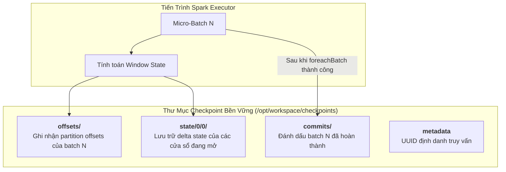
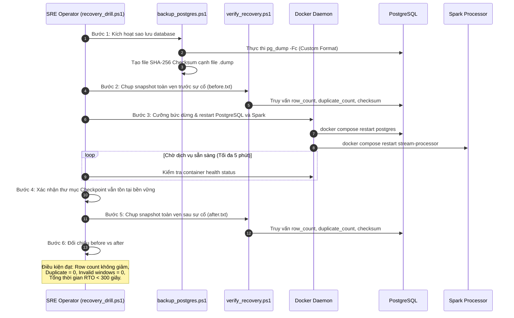

# Chuyên Đề 10: Khả Năng Chịu Lỗi & Phục Hồi Sau Sự Cố

## 1. Tổng Quan Về Khả Năng Chịu Lỗi (Fault Tolerance Overview)

Trong một kiến trúc xử lý dữ liệu phân tán hoạt động liên tục 24/7, sự cố phần cứng, sập nguồn, tràn bộ nhớ (Out-Of-Memory) hoặc gián đoạn mạng không phải là ngoại lệ mà là một **điều tất yếu** sẽ xảy ra. Hệ thống **Cloud Stream IoT** được thiết kế dựa trên triết lý **Thiết kế để Chịu Lỗi (Design for Failure)**.

Khả năng chịu lỗi của hệ thống được đảm bảo thông qua sự phối hợp đồng bộ giữa 3 cơ chế:
1. **Lưu vết cam kết Write-Ahead Log (WAL) & Trạng thái Checkpoint của Apache Spark**.
2. **Commit Log bền vững của Broker Redpanda (Raft consensus)**.
3. **Thao tác ghi lũy thừa (Idempotent UPSERT) của PostgreSQL**.

---

## 2. Cơ Chế Spark Checkpointing & Quản Lý Trạng Thái Bền Vững

Checkpoint là cơ chế lưu trữ bền vững trạng thái tính toán của Spark Structured Streaming xuống một hệ thống tệp tin không khả biến.

### 2.1. Phân giải đường dẫn và Mount Volume
- Đường dẫn cấu hình: `checkpoint_location: checkpoints/spark_pipeline`.
- Trong `docker-compose.yml`: Thư mục cục bộ `./checkpoints` trên host được ánh xạ vào `/opt/workspace/checkpoints` trong container `spark-processor`.
- Hàm `resolve_checkpoint_path()` tự động nhận diện biến môi trường `CHECKPOINT_ROOT=/opt/workspace/checkpoints`, đảm bảo tệp checkpoint được ghi trực tiếp ra ổ đĩa máy chủ, không bị mất đi khi container bị xóa hoặc tạo lại.

### 2.2. Khôi phục Offset Kafka (Offset Recovery)
- Cấu hình nguồn Spark sử dụng: `.option("startingOffsets", "earliest")`.
- **Hành vi khi khởi động lại**: Spark kiểm tra thư mục `offsets/` và `commits/`. Nếu tồn tại checkpoint, Spark **bỏ qua giá trị `earliest`** và tiếp tục đọc chính xác từ offset tiếp theo của batch chưa hoàn tất. Điều này đảm bảo không đọc trùng lặp các thông điệp đã được xử lý xong từ trước sự cố.

---

## 3. Phân Tích Các Kịch Bản Sự Cố & Cơ Chế Ứng Phó

### 3.1. Kịch Bản 1: Tiến Trình Spark Bị Dừng Cưỡng Bức (Spark Process Crash)
- **Mô phỏng**: Thực thi `docker compose kill stream-processor` hoặc tiến trình JVM bị lỗi OOM.
- **Hệ quả tức thời**:
  - Dữ liệu cảm biến từ Generator vẫn tiếp tục được gửi vào Redpanda và lưu đệm an toàn trong các partition.
  - Consumer Lag bắt đầu tăng lên do không có consumer tiêu thụ.
- **Cơ chế phục hồi**:
  - Khi container Spark được khởi động lại (`docker compose start stream-processor`), Spark đọc tệp checkpoint gần nhất.
  - Tái tạo trạng thái các cửa sổ đang mở từ thư mục `state/0/0/`.
  - Tiếp tục đọc dữ liệu từ Redpanda tại mốc offset chưa commit.
  - Nhờ cơ chế `ON CONFLICT DO UPDATE` tại PostgreSQL, các bản ghi thuộc batch đang dở dang được cập nhật lại nguyên tử mà không sinh ra bản ghi trùng lặp.

### 3.2. Kịch Bản 2: Message Broker (Redpanda) Bị Gián Đoạn (Broker Failure)
- **Mô phỏng**: Container `redpanda` bị dừng đột ngột (`docker compose stop redpanda`).
- **Hệ quả tức thời**:
  - Generator không thể gửi gói tin mới, kích hoạt hàm callback `_on_send_error` in log lỗi.
  - Spark gặp lỗi gián đoạn kết nối Kafka (`TimeoutException`), tạm dừng vi mô chờ broker phục hồi.
- **Cơ chế phục hồi**:
  - Khởi động lại Redpanda (`docker compose start redpanda`).
  - Redpanda khôi phục trạng thái topic từ volume mount `./volumes/redpanda`.
  - Khi healthcheck báo `healthy`, Generator tự động kết nối lại và tiếp tục phát dữ liệu.
  - Spark tự động tái lập kết nối (Auto-reconnect) và tiếp tục tiêu thụ hàng đợi dồn ứ.

> [!NOTE]
> *Kinh nghiệm thực tế*: Trong quá trình thử nghiệm, nếu Redpanda bị tắt đột ngột nhiều lần có thể xuất hiện tình trạng `leaderless_partitions`. Trong trường hợp này, cần dùng lệnh `rpk cluster health` để kiểm tra trước khi kết luận pipeline bị lỗi.

### 3.3. Kịch Bản 3: Cơ Sở Dữ Liệu PostgreSQL Bị Dừng (Database Failure)
- **Mô phỏng**: Container `postgres` bị sập khi Spark đang chuẩn bị ghi dữ liệu.
- **Hệ quả tức thời**:
  - `write_batch()` thất bại do không lấy được kết nối từ `PsycopgConnectionPool`.
  - Spark nhận ngoại lệ, vi mô batch hiện tại không thể commit vào thư mục `commits/`.
  - Spark Structured Streaming tạm dừng hoặc dừng có kiểm soát, giữ nguyên offset chưa cam kết.
- **Cơ chế phục hồi**:
  - Khởi động lại PostgreSQL.
  - Khởi động lại Spark: Spark phát hiện batch trước đó chưa có tệp commit tương ứng, tiến hành nạp lại toàn bộ dữ liệu của batch đó và thực thi lại hàm `write_batch()`.
  - Kết quả được ghi đè an toàn vào PostgreSQL.

---

## 4. Quy Trình Diễn Tập Khôi Phục Thảm Họa (Disaster Recovery Drill)

Dự án đóng gói toàn bộ quy trình kiểm chứng khả năng chịu lỗi thành một kịch bản tự động hóa tại [`ops/recovery_drill.ps1`](../ops/recovery_drill.ps1).

### Các điều kiện kiểm tra nghiêm ngặt trong kịch bản:
- `row_count` và `logical_row_count` sau sự cố không được phép nhỏ hơn trước sự cố:
  $$N_{\text{after}} \ge N_{\text{before}}$$
- Số lượng bản ghi trùng lặp khóa chính sau sự cố bắt buộc bằng 0:
  $$\text{duplicate\_count}_{\text{after}} == 0$$
- Số lượng cửa sổ có mốc thời gian ngược (`window_end <= window_start`) bắt buộc bằng 0:
  $$\text{invalid\_windows}_{\text{after}} == 0$$
- Tổng thời gian hoàn tất quy trình từ lúc bắt đầu backup đến khi thẩm định xong toàn vẹn phải nhỏ hơn 300 giây (5 phút).

---

## 5. Kết Quả Đo Lường Thời Gian Phục Hồi (RTO Evidence)

Trong môi trường thực nghiệm tại máy trạm cục bộ, kịch bản `ops/recovery_drill.ps1` đã được chạy thực tế và ghi nhận kết quả:

- **Mục tiêu RTO lý thuyết**: $< 300$ giây (5 phút).
- **Thời gian đo đạc thực tế**: **Khoảng $19.5$ giây** (hoàn tất toàn bộ các bước: sao lưu `pg_dump`, sinh mã băm SHA-256, chụp snapshot SQL, restart đồng thời 2 container, chờ healthcheck vượt qua và thẩm định lại toàn vẹn).
- **Trạng thái tính toàn vẹn**:
  - `duplicate_count`: $0$ (Không có bất kỳ bản ghi trùng lặp nào).
  - `invalid_windows`: $0$ (Tất cả cửa sổ đều có `window_end > window_start`).
  - Thư mục Checkpoint: Toàn vẹn, Spark tiếp tục phát hành batch mới bình thường.

> [!NOTE]
> Kết quả đo đạc 19.5 giây phản ánh hiệu năng trên cấu hình máy trạm SSD NVMe cục bộ. Khi vận hành trên hạ tầng cloud với khối lượng dữ liệu hàng triệu dòng, thời gian khôi phục có thể kéo dài hơn nhưng vẫn nằm trong hạn mức cam kết RTO 300 giây.

---

## 6. Hạn Chế Vận Hành & Khả Năng Tin Cậy Đã Biết (Known Limitations)

Mặc dù kiến trúc chịu lỗi đã được chứng minh qua thực nghiệm, một số hạn chế cần được lưu ý:
1. **Thiếu cơ chế tự động chuyển vùng dự phòng (No Automatic Failover)**:
   - Các dịch vụ chạy dưới dạng single-node container. Nếu node máy chủ vật lý gặp sự cố phần cứng, toàn bộ hệ thống sẽ dừng hoạt động cho đến khi có sự can thiệp thủ công của quản trị viên (chưa có cụm Kubernetes đa node tự động lập lịch lại Pod).
2. **Nguy cơ nghẽn đĩa Checkpoint (Checkpoint Disk Bloat)**:
   - Spark Structured Streaming ghi nhận các tệp delta trạng thái liên tục. Nếu không cấu hình dọn dẹp các commit cũ hoặc không chạy tiến trình compaction, số lượng tệp tin trong `checkpoints/spark_pipeline/state` có thể lên tới hàng chục nghìn tệp nhỏ, gây chậm trễ hệ thống tệp tin (File System Metadata Overhead).
3. **Mất thông điệp chưa commit tại Generator**:
   - Generator là một script Python đơn giản, không duy trì local write-ahead log. Nếu container `event-generator` bị sập đột ngột, các sự kiện đang nằm trong bộ nhớ RAM của tiến trình chưa kịp gửi qua socket sẽ bị mất đi vĩnh viễn.

