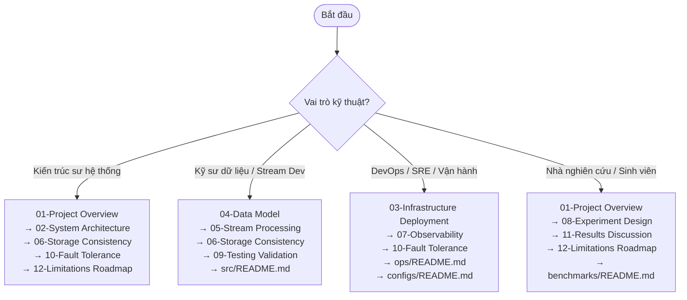

# Hệ Thống Tài Liệu Kỹ Thuật Toàn Diện — Cloud Stream IoT (Đề tài 16)

Hệ thống tài liệu này cung cấp bản đặc tả kiến trúc, thiết kế kỹ thuật, mô hình dữ liệu, cơ chế vận hành, kiểm thử và phân tích thực nghiệm cho dự án **Cloud Stream IoT** (Đề tài 16). 

Dự án tập trung nghiên cứu hành vi xử lý luồng dữ liệu IoT thời gian thực trên nền tảng **Apache Spark Structured Streaming**, **Redpanda (Kafka-compatible)** và **PostgreSQL**, đặc biệt đi sâu vào các khía cạnh: **độ trễ đầu cuối (end-to-end latency)**, **xử lý dữ liệu đến muộn (late data handling)** qua cơ chế **Watermark**, **áp lực ngược (backpressure)**, **tính bất biến/idempotency** và **khả năng chịu lỗi (fault-tolerance)**.

---

## 1. Cấu Trúc Bộ Tài Liệu

Bộ tài liệu kỹ thuật được chuẩn hóa thành 12 chuyên đề chuyên sâu và 5 tài liệu thành phần:

| Mã Tài Liệu | Tên Tài Liệu & Chuyên Đề | Trọng Tâm Kỹ Thuật | Trạng Thái |
|---|---|---|---|
| [`01`](./01-project-overview.md) | [Tổng Quan Dự Án & Động Lực Nghiên Cứu](./01-project-overview.md) | Bối cảnh IoT, bài toán late data, câu hỏi nghiên cứu, KPI và phân công nhóm | **IMPLEMENTED** |
| [`02`](./02-system-architecture.md) | [Kiến Trúc Hệ Thống & Luồng Dữ Liệu](./02-system-architecture.md) | Kiến trúc As-Is, luồng dữ liệu end-to-end, network container, ranh giới trách nhiệm | **IMPLEMENTED** |
| [`03`](./03-infrastructure-deployment.md) | [Hạ Tầng Triển Khai & Containerization](./03-infrastructure-deployment.md) | Docker Compose 8 services, ports, volumes, biến môi trường, healthcheck, tài nguyên | **IMPLEMENTED** |
| [`04`](./04-data-model.md) | [Mô Hình Dữ Liệu & Hợp Đồng Sự Kiện](./04-data-model.md) | JSON Event Schema, Event-time vs Processing-time, logic sinh dữ liệu trễ 20%, SQL DDL | **IMPLEMENTED** |
| [`05`](./05-stream-processing.md) | [Xử Lý Luồng Với Spark Structured Streaming](./05-stream-processing.md) | Tumbling window 1 phút, watermark 120s, update mode, foreachBatch, router JSONL | **IMPLEMENTED** |
| [`06`](./06-storage-consistency.md) | [Lưu Trữ Bền Vững & Ngữ Nghĩa Giao Nhận](./06-storage-consistency.md) | PostgreSQL UPSERT idempotency, Connection Pool, At-least-once to Effectively Once, 4-tier logs | **IMPLEMENTED** |
| [`07`](./07-observability.md) | [Giám Sát Hệ Thống & Số Liệu Vận Hành](./07-observability.md) | Prometheus metrics, cAdvisor, Grafana 3 dashboards, phân biệt Real vs Simulated | **PARTIAL** |
| [`08`](./08-experiment-design.md) | [Thiết Kế Thực Nghiệm & Đo Đạc](./08-experiment-design.md) | 5 kịch bản EXP-01 đến EXP-05 (Baseline, Watermark, Partitions, Backpressure, Recovery) | **IMPLEMENTED** |
| [`09`](./09-testing-validation.md) | [Chiến Lược Kiểm Thử & Xác Thực Toàn Vẹn](./09-testing-validation.md) | Unit test, Spark Integration test, Live E2E test, SQL Integrity check, Batch audit | **IMPLEMENTED** |
| [`10`](./10-fault-tolerance.md) | [Khả Năng Chịu Lỗi & Phục Hồi Sau Sự Cố](./10-fault-tolerance.md) | Checkpoint WAL, Offset commit, drill restart < 300s, kịch bản crash Broker/DB/Spark | **IMPLEMENTED** |
| [`11`](./11-results-discussion.md) | [Kết Quả Thực Nghiệm & Thảo Luận Khoa Học](./11-results-discussion.md) | Phân tích 4 giai đoạn ép tải, bảng kết quả TODO, trả lời trực diện câu hỏi nghiên cứu | **IMPLEMENTED** |
| [`12`](./12-limitations-roadmap.md) | [Hạn Chế Kỹ Thuật & Lộ Trình Phát Triển](./12-limitations-roadmap.md) | Kiểm toán lỗi hiện tại, ClickHouse discrepancy, bảo mật secret, lộ trình ưu tiên | **IMPLEMENTED** |

### Tài Liệu Thành Phần (Component READMEs):
- [`src/README.md`](../src/README.md): Hướng dẫn mã nguồn ứng dụng, tiêu chuẩn lập trình, kiến trúc module.
- [`ops/README.md`](../ops/README.md): Sổ tay vận hành (Runbook) sao lưu, phục hồi và diễn tập thảm họa (Disaster Recovery Drill).
- [`benchmarks/README.md`](../benchmarks/README.md): Hướng dẫn thực thi kịch bản đo tải, mô hình ép tải 4 pha.
- [`configs/README.md`](../configs/README.md): Đặc tả chi tiết các tham số cấu hình YAML, SQL schema và scrape target Prometheus.
- [`tests/README.md`](../tests/README.md): Hướng dẫn kiểm thử tự động, điều kiện tiên quyết và tiêu chí nghiệm thu Pass/Fail.

---

## 2. Lộ Trình Đọc Khuyến Nghị (Reading Order)

Tùy theo vai trò kỹ thuật, khuyến nghị tiếp cận bộ tài liệu theo các hướng sau:

---

## 3. Tổng Hợp Kiểm Toán Mã Nguồn (Repository Audit Summary)

Toàn bộ hiện trạng mã nguồn được rà soát trực tiếp và phân loại khách quan:

| Thành phần kỹ thuật | Vị trí mã nguồn | Phân loại | Mô tả hiện trạng |
|---|---|---|---|
| **Event Generator** | `src/generator/event_producer.py` | **IMPLEMENTED** | Phát 10 msg/s, 20% simulated late data, kết nối Redpanda qua KafkaProducer. |
| **Event Schema & Validator** | `src/generator/event_schema.py` | **IMPLEMENTED** | Kiểm tra strict typing, timezone UTC, biên nhiệt độ (20-85), độ ẩm (30-90). |
| **Broker Hạ Tầng** | `docker-compose.yml` (`redpanda`) | **IMPLEMENTED** | Redpanda v24.3.8 chạy 1 node, memory limit 1.5GB, SMP 1. |
| **Web Console Broker** | `docker-compose.yml` (`redpanda-console`) | **IMPLEMENTED** | Giao diện Web cổng 18080 theo dõi topics, consumer groups, partition offset. |
| **Cơ Sở Dữ Liệu Đích** | `docker-compose.yml` (`postgres`), `database_schema.sql` | **IMPLEMENTED** | PostgreSQL 16.4 Alpine, DDL bảng `sensor_window_metrics` với khóa chính tổng hợp. |
| **Spark Structured Streaming** | `src/streaming/spark_pipeline.py` | **IMPLEMENTED** | Đọc Kafka earliest, tumbling window 1m, watermark 120s, foreachBatch UPSERT connection pool. |
| **Late Data Router** | `src/streaming/late_data_router.py` | **PARTIAL** | Script tách riêng 4 file JSONL (raw, accepted, late, dead_letter); chưa đưa vào Compose. |
| **Batch Evaluator** | `src/batch/batch_evaluator.py` | **IMPLEMENTED** | Đối chiếu cân bằng dòng dữ liệu giữa 4 file log JSONL và kiểm tra trùng lặp DB. |
| **Spark Checkpointing** | `checkpoints/spark_pipeline` | **IMPLEMENTED** | Gắn kết bind-mount bền vững, lưu delta state và offset commit. |
| **Ops & Disaster Recovery** | `ops/backup_postgres.ps1`, `recovery_drill.ps1` | **IMPLEMENTED** | Backup pg_dump Fc, checksum SHA-256, diễn tập khôi phục tự động hoàn tất < 300s. |
| **Smoke & Regression Tests** | `tests/test_smoke_pipeline.py` | **IMPLEMENTED** | 4 Test suites bao gồm unit test, Spark local integration, DB upsert, E2E live. |
| **SQL Integrity Checks** | `tests/sql/run_integrity_check.py` | **IMPLEMENTED** | Chạy 3 kiểm tra logic: NOT NULL key, window bounds, duplicate logical rows. |
| **Monitoring Gốc** | `docker-compose.yml` (`prometheus`, `grafana`, `cadvisor`) | **PARTIAL** | Thu thập cAdvisor và Redpanda; chưa có cấu hình scrape Spark processor thực tế. |
| **Monitoring Dashboard NhutTan** | `NhutTan/docker-compose.monitoring.yml` | **IMPLEMENTED** | Prometheus (9090) & Grafana (3000) với 3 dashboard JSON tự động provision. |
| **Spark Metrics Exporter** | `NhutTan/src/start_live_metrics_server.py` | **SIMULATED** | Phát metrics giả lập 4 pha (Baseline, Ramp-up, Stress, Cool-down) trên cổng 8000; chưa trích xuất metrics trực tiếp từ tiến trình Spark container. |
| **Kịch Bản Benchmark Tự Động** | `benchmarks/run_*.sh` | **PLACEHOLDER** | Script shell hiện chỉ có chú thích 2 dòng, chưa hiện thực hóa logic tự động hóa benchmark. |
| **ClickHouse Storage Sink** | `volumes/clickhouse` | **PLANNED** | Thư mục dữ liệu tồn tại nhưng service không có trong `docker-compose.yml`. |

---

## 4. Quy Ước Nhãn Trạng Thái Kỹ Thuật (Convention Legend)

Trong toàn bộ hệ thống tài liệu, các nhãn trạng thái sau được áp dụng nhất quán:

- [IMPLEMENTED]: Thành phần đã được lập trình hoàn chỉnh, mã nguồn có mặt trong repository và có bài kiểm thử unit/integration tương ứng.
- [PARTIAL]: Thành phần đã hoàn thành phần lõi logic hoặc chạy ở chế độ standalone script, nhưng chưa được tích hợp trọn vẹn vào pipeline dịch vụ chính.
- [PLACEHOLDER]: Khung sườn file đã tạo sẵn trong repository nhưng mã thực thi chưa được viết.
- [PLANNED]: Ý tưởng hoặc thành phần được hoạch định trong kiến trúc tương lai (như ClickHouse OLAP sink, Cloud deployment).
- [SIMULATED]: Số liệu hoặc endpoint phục vụ thử nghiệm giả lập (như live metrics server chu kỳ 180s), không phản ánh số đo từ runtime thực.
- [BROKEN/INCONSISTENT]: Có sự sai lệch giữa tài liệu, cấu hình hoặc xung đột tham số runtime.
- [UNVERIFIED] / [Not Runtime Verified]: Tính năng đã viết mã nhưng chưa được xác thực bằng log đo lường trực tiếp trong môi trường chạy thật.

