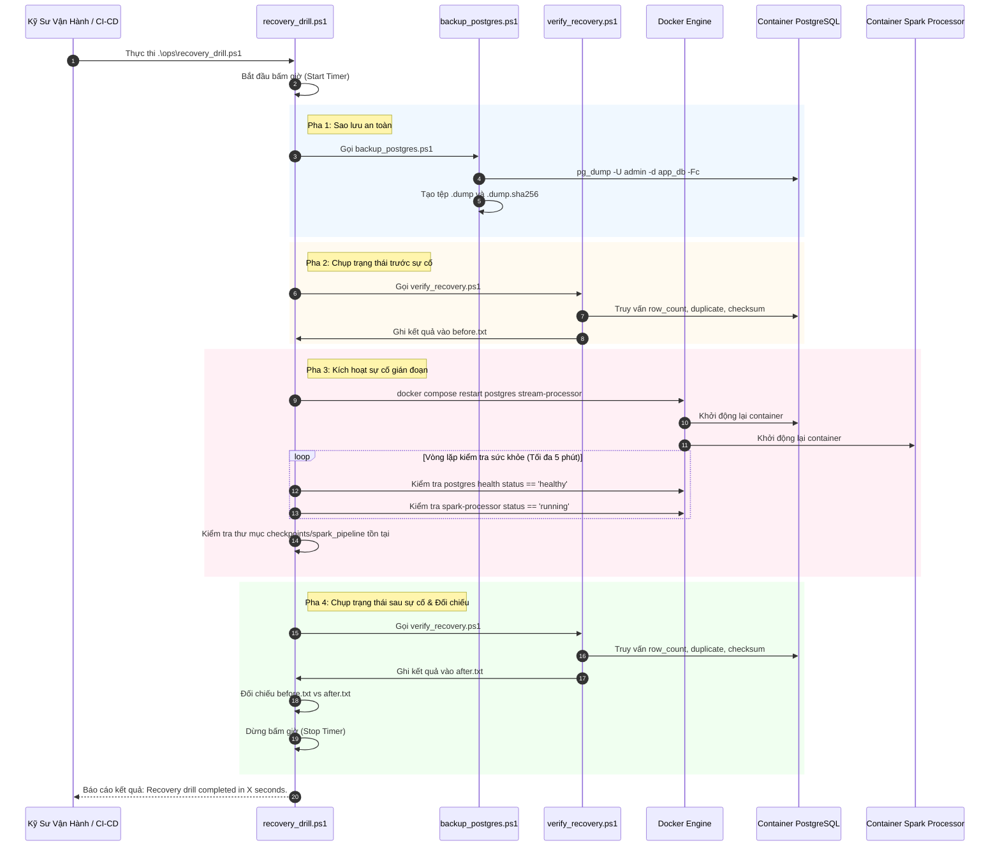

# Sổ Tay Vận Hành Kỹ Thuật (SRE Runbook) — `ops/`

Thư mục `ops/` chứa toàn bộ các kịch bản tự động hóa vận hành (**Site Reliability Engineering - SRE Scripts**) của dự án **Cloud Stream IoT**, tập trung vào các quy trình: sao lưu dự phòng (**Backup**), khôi phục dữ liệu (**Restore**), thẩm định tính toàn vẹn (**Integrity Verification**) và diễn tập phục hồi thảm họa tự động có bấm giờ (**Disaster Recovery Drill**).

---

## 1. Mục Tiêu Vận Hành & Cam Kết SLA (Service Level Agreements)

- **Mục tiêu Thời Gian Phục Hồi (Recovery Time Objective - RTO)**: Hoàn tất toàn bộ quy trình sao lưu, khởi động lại dịch vụ và thẩm định toàn vẹn trong thời gian **nhỏ hơn 300 giây (5 phút)**. *(Thời gian đo đạc thực tế tại môi trường local đạt ~19.5 giây)*.
- **Mục tiêu Điểm Phục Hồi (Recovery Point Objective - RPO)**: Nhờ sự phối hợp giữa Spark Checkpoint và commit log Redpanda, dữ liệu chưa ghi nhận được phát lại đầy đủ, đảm bảo $\text{RPO} \approx 0$.
- **Cam kết Toàn Vẹn Dữ Liệu**: Số lượng bản ghi trùng lặp khóa chính logic sau phục hồi bắt buộc bằng **0** (`duplicate_count == 0`), không có cửa sổ ngược thời gian (`invalid_windows == 0`).

---

## 2. Danh Mục Các Kịch Bản Vận Hành Trong `ops/`

| Tệp Kịch Bản (PowerShell) | Chức Năng Chính | Tham Số Đầu Vào Quan Trọng | Tác Vụ Thực Thi |
|---|---|---|---|
| [`backup_postgres.ps1`](./backup_postgres.ps1) | Sao lưu cơ sở dữ liệu PostgreSQL | `-BackupDirectory`, `-Container`, `-Database`, `-User` | Thực thi `pg_dump -Fc` (Custom format), trích xuất file `.dump` ra host và tính mã băm SHA-256 lưu vào `.dump.sha256`. |
| [`restore_postgres.ps1`](./restore_postgres.ps1) | Khôi phục cơ sở dữ liệu từ bản sao lưu | `-BackupFile` (Bắt buộc), `-ConfirmRestore` (Switch) | Kiểm tra mã băm SHA-256, đẩy file vào container và thực thi lệnh `pg_restore --clean --if-exists`. |
| [`verify_recovery.ps1`](./verify_recovery.ps1) | Thẩm định tính toàn vẹn dữ liệu | `-Container`, `-Database`, `-User`, `-OutputPath` | Truy vấn kiểm tra `row_count`, `duplicate_count`, `result_checksum`, số lượng `invalid_windows` và xuất ra tệp snapshot. |
| [`recovery_drill.ps1`](./recovery_drill.ps1) | Diễn tập phục hồi thảm họa toàn diện | `-Container`, `-SparkService`, `-CheckpointPath`, `-EvidenceDirectory` | Tự động hóa 6 bước: Backup $\rightarrow$ Snapshot Before $\rightarrow$ Restart Services $\rightarrow$ Chờ Healthcheck $\rightarrow$ Snapshot After $\rightarrow$ So sánh đối chiếu & bấm giờ. |

---

## 3. Quy Trình Diễn Tập Phục Hồi Thảm Họa (Disaster Recovery Drill)

Kịch bản `ops/recovery_drill.ps1` thực thi toàn bộ chu trình khôi phục sự cố theo sơ đồ tuần tự chuẩn:



---

## 4. Hướng Dẫn Vận Hành Từng Bước (Operator's Step-by-Step Guide)

### 4.1. Tạo bản sao lưu định kỳ (Manual Backup)
Chạy lệnh tại thư mục gốc của dự án:
```powershell
.\ops\backup_postgres.ps1
```
Kết quả sinh ra trong thư mục `backups/postgres/`:
- Tệp dữ liệu: `app_db-YYYYMMDD-HHMMSS.dump`
- Tệp mã băm kiểm tra: `app_db-YYYYMMDD-HHMMSS.dump.sha256`

### 4.2. Khôi phục cơ sở dữ liệu khi có sự cố (Manual Restore)
> [!CAUTION]
> Lệnh restore là một thao tác có tính phá hủy (Destructive Action), sẽ ghi đè toàn bộ dữ liệu bảng hiện tại. Luôn tạo backup hiện trạng trước khi chạy và bắt buộc phải truyền cờ `-ConfirmRestore`:

```powershell
# 1. Tạo backup an toàn trước khi restore
.\ops\backup_postgres.ps1

# 2. Thực thi restore bản backup mới nhất
$latestBackup = (Get-ChildItem .\backups\postgres\*.dump | Sort-Object LastWriteTime -Descending | Select-Object -First 1).FullName
.\ops\restore_postgres.ps1 -BackupFile $latestBackup -ConfirmRestore

# 3. Kiểm tra tính toàn vẹn sau khi restore
.\ops\verify_recovery.ps1
```

### 4.3. Chạy diễn tập phục hồi tự động (Execute Recovery Drill)
```powershell
# Tạo thư mục lưu vết bằng chứng
New-Item -ItemType Directory -Force .\recovery-evidence | Out-Null

# Chạy diễn tập và ghi log toàn bộ transcript
.\ops\recovery_drill.ps1 *>&1 | Tee-Object .\recovery-evidence\recovery-drill-$(Get-Date -Format yyyyMMdd-HHmmss).log
```

---

## 5. Bảng Tiêu Chí Nghiệm Thu Diễn Tập (Pass/Fail Acceptance Criteria)

| Tiêu Chí Thẩm Định | Điều Kiện Đạt Chuẩn (PASS) | Điều Kiện Báo Lỗi (FAIL) | Ý Nghĩa Kỹ Thuật |
|---|:---:|:---:|---|
| **Thời Gian Phục Hồi (RTO)** | $T_{\text{elapsed}} \le 300.0$ giây | $T_{\text{elapsed}} > 300.0$ giây | Đảm bảo hệ thống phục hồi trong khung giờ cam kết với doanh nghiệp. |
| **Tính Không Giảm Dữ Liệu** | $N_{\text{after}} \ge N_{\text{before}}$ | $N_{\text{after}} < N_{\text{before}}$ | Số lượng bản ghi sau restart không được giảm (có thể tăng do generator vẫn đang phát). |
| **Bản Ghi Trùng Lặp (Duplicates)** | $\text{duplicate\_count} == 0$ | $\text{duplicate\_count} > 0$ | Khẳng định cơ chế PostgreSQL UPSERT Idempotency hoạt động hoàn hảo. |
| **Tính Hợp Lệ Của Cửa Sổ** | $\text{invalid\_windows} == 0$ | $\text{invalid\_windows} > 0$ | Không có cửa sổ nào có mốc thời gian kết thúc nhỏ hơn hoặc bằng mốc bắt đầu. |
| **Tính Toàn Vẹn Checkpoint** | Thư mục `checkpoints/spark_pipeline` tồn tại | Thư mục bị mất hoặc bị rỗng | Đảm bảo volume bind-mount không bị Docker làm biến mất sau khi restart. |
| **Trạng Thái Container** | PostgreSQL `healthy`, Spark `running` | Container bị exit hoặc restart loop | Các tiến trình dịch vụ sống sót và tự động tái lập kết nối thành công. |

---

## 6. Kế Hoạch Ứng Phó Sự Cố (Incident Response Playbook)

### Kịch bản A: Cơ sở dữ liệu bị hỏng hoặc bảng bị xóa ngoài ý muốn
1. Dừng container Spark để tạm ngắt luồng ghi: `docker compose stop stream-processor`.
2. Kiểm tra danh sách file backup có sẵn trong `backups/postgres/`.
3. Chạy `restore_postgres.ps1` với file dump gần nhất có mã băm SHA-256 hợp lệ.
4. Chạy `verify_recovery.ps1` xác nhận bảng `sensor_window_metrics` đã phục hồi dữ liệu.
5. Khởi động lại Spark: `docker compose start stream-processor`.

### Kịch bản B: Redpanda báo lỗi `leaderless_partitions`
1. Kiểm tra sức khỏe cụm broker: `docker exec redpanda rpk cluster health --api-urls localhost:9644`.
2. Kiểm tra chi tiết topic: `docker exec redpanda rpk topic describe iot-sensor-events`.
3. Nếu topic bị mất leader vĩnh viễn và chấp nhận mất dữ liệu hàng đợi Kafka cũ:
   ```powershell
   docker exec redpanda rpk topic delete iot-sensor-events
   docker exec redpanda rpk topic create iot-sensor-events --partitions 3
   docker compose restart stream-processor event-generator
   ```

