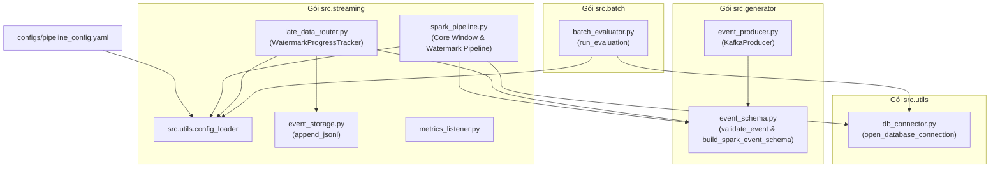

# Mã Nguồn Ứng Dụng (Application Source Code) — `src/`

Thư mục `src/` chứa toàn bộ mã nguồn ứng dụng lõi của hệ thống **Cloud Stream IoT**, bao gồm các module phát sinh dữ liệu, xử lý luồng phân tán Spark Structured Streaming, định tuyến dữ liệu muộn, thẩm định hậu thực nghiệm và các tiện ích kết nối hạ tầng.

---

## 1. Cấu Trúc Gói Mã Nguồn (Package Architecture)

```text
src/
├── generator/                  # Tầng sinh dữ liệu & kiểm thực schema
│   ├── __init__.py
│   ├── event_schema.py         # Quy tắc validation độc lập & Spark StructType
│   └── event_producer.py       # KafkaProducer phát sự kiện IoT kèm dữ liệu trễ 20%
├── streaming/                  # Tầng xử lý luồng thời gian thực
│   ├── __init__.py
│   ├── spark_pipeline.py       # Pipeline chính: Tumbling Window, Watermark, PostgreSQL UPSERT
│   ├── late_data_router.py     # Định tuyến dữ liệu muộn qua WatermarkProgressTracker
│   ├── event_storage.py        # Thao tác đọc/ghi bền vững 4 tệp nhật ký JSONL
│   └── metrics_listener.py     # Wrapper tích hợp StreamingQueryListener và Prometheus metrics
├── batch/                      # Tầng thẩm định hậu thực nghiệm
│   ├── __init__.py
│   └── batch_evaluator.py      # Báo cáo đối chiếu cân bằng dữ liệu & trùng lặp DB
└── utils/                      # Thư viện tiện ích dùng chung
    ├── __init__.py
    ├── config_loader.py        # Nạp cấu hình YAML và giải quyết biến môi trường
    └── db_connector.py         # Mở kết nối psycopg2 kết nối PostgreSQL
```

---

## 2. Sơ Đồ Tương Tác Giữa Các Module (Module Interaction)



---

## 3. Đặc Tả Chi Tiết Từng Module

### 3.1. Gói `src.generator`
- **`event_schema.py`**:
  - `validate_event(event: Mapping[str, Any])`: Xác thực cấu trúc từ điển sự kiện. Đảm bảo có đủ 6 trường bắt buộc, không thừa trường ngoài hợp đồng, `event_time` có timezone, miền nhiệt độ $[20.0, 85.0]$, miền độ ẩm $[30.0, 90.0]$, status $\in \{'OK', 'CRITICAL'\}$ và `is_late_simulated` là boolean. Ném ra ngoại lệ `EventValidationError` nếu vi phạm.
  - `build_spark_event_schema() -> StructType`: Tạo schema tĩnh cho Apache Spark tương ứng 100% với contract.
- **`event_producer.py`**:
  - `generate_sensor_event(...)`: Sinh sự kiện cảm biến ngẫu nhiên. Áp dụng xác suất `late_data_percent` (mặc định 0.20) để lùi `event_time` từ 30s đến 120s so với thời gian thực `datetime.now(timezone.utc)`.
  - `main()`: Vòng lặp phát thông điệp liên tục qua `KafkaProducer`, sử dụng `device_id` làm partition key và in thống kê tỷ lệ trễ sau mỗi 20 sự kiện.

### 3.2. Gói `src.streaming`
- **`spark_pipeline.py`**:
  - `PsycopgConnectionPool`: Lớp quản lý kết nối cơ sở dữ liệu thread-safe dựa trên `psycopg2.pool.ThreadedConnectionPool(minconn=1, maxconn=4)`.
  - `build_windowed_events(events, streaming)`: Khai báo `.withWatermark("event_time", "120 seconds")`, gom nhóm Tumbling Window 1 phút và tính `count(*)`, `avg(temperature)`, `avg(humidity)`.
  - `write_batch(batch_df, batch_id, pool)`: Thu thập kết quả và thực thi câu lệnh SQL UPSERT:
    `INSERT INTO sensor_window_metrics (...) ON CONFLICT (window_start, window_end, device_id) DO UPDATE ...`.
  - `resolve_checkpoint_path(configured_path)`: Tự động phân giải đường dẫn checkpoint tương thích giữa máy host cục bộ và container Docker.
- **`late_data_router.py`**:
  - `WatermarkProgressTracker`: Kế thừa `StreamingQueryListener`, trích xuất giá trị watermark thời gian thực từ `event.progress.eventTime.get("watermark")`.
  - `route_batch()`: Định tuyến dữ liệu thành 4 luồng kiểm toán bền vững: `raw_events.jsonl`, `dead_letter.jsonl`, `accepted_events.jsonl` và `late_data.jsonl`.
- **`event_storage.py`**:
  - `append_jsonl(path, records)`: Ghi dồn các bản ghi vào tệp JSONL với `flush()` tức thời, tự động chuyển đổi đối tượng `datetime` sang chuỗi ISO-8601 qua `json_default`.
- **`metrics_listener.py`**:
  - Xuất bản các hằng số và listener hỗ trợ Prometheus scraping (chuyển tiếp tới mã nguồn trong `NhutTan/src/spark_metrics_listener.py`).

### 3.3. Gói `src.batch`
- **`batch_evaluator.py`**:
  - `count_window_records(database)`: Đếm tổng số dòng hiện có trong `sensor_window_metrics`.
  - `check_duplicate_windows(database)`: Truy vấn phát hiện các nhóm khóa chính logic bị trùng lặp (`HAVING COUNT(*) > 1`).
  - `compute_window_stats(database)`: Tính toán số lượng thiết bị duy nhất, giá trị sự kiện min/max/avg, mốc thời gian sớm nhất/muộn nhất.
  - `evaluate_late_data_accounting(log_dir)`: Đếm số dòng của 4 tệp JSONL và tính số lượng sự kiện chưa được phân loại:
    $$N_{unclassified} = N_{raw} - (N_{accepted} + N_{late} + N_{dead\_letter})$$

### 3.4. Gói `src.utils`
- **`config_loader.py`**: Đọc `configs/pipeline_config.yaml` và ưu tiên ghi đè bằng các biến môi trường Docker (`KAFKA_BOOTSTRAP_SERVERS`, `DB_HOST`, `DB_PORT`, `DB_USER`, `DB_PASSWORD`, `DB_NAME`). Kiểm tra bắt buộc phải có mật khẩu database.
- **`db_connector.py`**: Hàm `open_database_connection(database)` mở kết nối trực tiếp `psycopg2.connect()` có kiểm tra đủ các tham số bắt buộc.

---

## 4. Hướng Dẫn Thực Thi Cục Bộ Không Qua Docker (Local Execution)

Nếu muốn chạy trực tiếp các module bằng môi trường ảo Python trên máy trạm:

### Điều kiện tiên quyết:
- Đã cài đặt Python 3.10+ và Java OpenJDK 17.
- Đã cài đặt dependencies:
  ```powershell
  pip install -r requirements.txt
  ```
- Thiết lập biến môi trường bắt buộc:
  ```powershell
  $env:PYTHONPATH = "F:\Python\cloud-stream-project"
  $env:POSTGRES_PASSWORD = "your_secure_password"
  ```

### 1. Chạy Event Generator cục bộ:
```powershell
python src/generator/event_producer.py
```

### 2. Chạy Spark Pipeline cục bộ:
*(Yêu cầu Redpanda và PostgreSQL đang chạy và ánh xạ cổng ra host)*:
```powershell
$env:DB_PORT = "15432"
$env:KAFKA_BOOTSTRAP_SERVERS = "localhost:19092"
python src/streaming/spark_pipeline.py
```

### 3. Chạy Đánh Giá Hậu Thực Nghiệm (Batch Evaluator):
```powershell
$env:DB_PORT = "15432"
python src/batch/batch_evaluator.py
```

---

## 5. Tiêu Chuẩn Lập Trình (Coding & Quality Standards)

Toàn bộ mã nguồn trong `src/` tuân thủ các quy tắc kỹ thuật nghiêm ngặt:
1. **Type Annotations**: Tất cả các hàm và phương thức công khai đều có khai báo kiểu dữ liệu đầu vào và đầu ra (`typing.Any`, `Mapping`, `Optional`).
2. **Quản trị Múi Giờ Tuyệt Đối (Timezone-Awareness)**: Tuyệt đối không dùng `datetime.now()` không múi giờ. Mọi thời điểm đều sử dụng `datetime.now(timezone.utc)`.
3. **Quản lý Tài Nguyên An Toàn**: Mọi kết nối Database và tệp tin đều được mở trong cấu trúc ngữ cảnh (`with connection:`, `with path.open():`) hoặc khối lệnh `try...finally` để đảm bảo giải phóng socket và descriptor.
4. **Bảo Mật Tiến Trình Non-Root**: Khi đóng gói vào Dockerfile, toàn bộ mã nguồn được cấp quyền thực thi cho các tài khoản đặc quyền tối thiểu (`spark` UID 1001, `generator` UID 1002).

