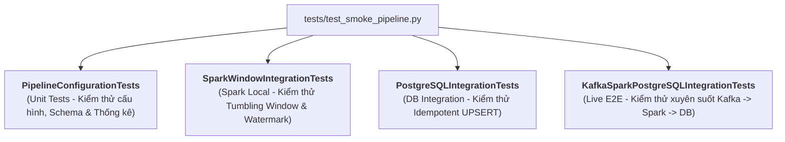

# Sổ Tay Kiểm Thử Tự Động (Testing Guide) — `tests/`

Thư mục `tests/` chứa toàn bộ hệ thống kiểm thử tự động (**Automated Test Suites**) và các kịch bản thẩm định toàn vẹn dữ liệu SQL của dự án **Cloud Stream IoT**.

---

## 1. Cấu Trúc Thư Mục Kiểm Thử

```text
tests/
├── __init__.py
├── test_smoke_pipeline.py      # Bộ kiểm thử hồi quy trung tâm (4 lớp test)
└── sql/                        # Kịch bản kiểm tra toàn vẹn cơ sở dữ liệu
    ├── run_integrity_check.py  # Script Python thực thi các truy vấn kiểm tra toàn vẹn
    └── verify_stream_integrity.sql # Tệp truy vấn SQL kiểm tra toàn vẹn và trùng lặp
```

---

## 2. Danh Mục Các Lớp Kiểm Thử Trong `test_smoke_pipeline.py`

Tệp [`tests/test_smoke_pipeline.py`](./test_smoke_pipeline.py) sử dụng framework chuẩn `unittest` của Python, được phân chia thành 4 lớp kiểm thử chuyên biệt:



### Bảng Chi Tiết Từng Lớp Test & Điều Kiện Thực Thi:

| Tên Lớp Kiểm Thử (Test Class) | Số Lượng Test Cases | Điều Kiện Tiên Quyết / Biến Kích Hoạt | Phạm Vi Xác Thực |
|---|:---:|---|---|
| `PipelineConfigurationTests` | 8 | Không (Chạy độc lập tức thì) | Cài đặt dependencies, nạp cấu hình YAML, format timezone ISO-8601 UTC, validation schema từ chối payload sai, tỷ lệ late data đạt $20\% \pm 2\%$, phân giải đường dẫn checkpoint. |
| `SparkWindowIntegrationTests` | 5 | Java 17 khả dụng trên máy host | Khởi tạo SparkSession local `local[1]`, gom nhóm cửa sổ 1 phút cho từng thiết bị, tính trung bình nhiệt độ/độ ẩm, định tuyến bản ghi muộn hơn cutoff vào `late-data.jsonl`, cân bằng sự kiện đầu vào. |
| `PostgreSQLIntegrationTests` | 1 | Cần `POSTGRES_PASSWORD` và PostgreSQL cổng 15432 sẵn sàng | Tự động tạo bảng DDL, chèn batch 1, chèn batch 2 cùng khóa chính và kiểm tra lệnh `ON CONFLICT DO UPDATE` ghi nhận giá trị mới nhất. |
| `KafkaSparkPostgreSQLIntegrationTests` | 1 | Cần cụm Docker đang chạy và `$env:RUN_LIVE_INTEGRATION = "1"` | Bơm 3 sự kiện thật vào Redpanda, đợi Watermark tiến qua cửa sổ, xác thực bản ghi xuất hiện trong PostgreSQL và tự động dọn dẹp. |

---

## 3. Điều Kiện Bỏ Qua Test (Skip Conditions)

Hệ thống kiểm thử được thiết kế thông minh để không gây lỗi giả (**False Negatives**) khi chạy trong các môi trường thiếu dịch vụ phụ thuộc:

1. **`SparkWindowIntegrationTests.test_watermark_drops_event_arriving_after_window_is_closed`**:
   - *Điều kiện*: Bỏ qua nếu chạy trên Windows (`os.name == 'nt'`).
   - *Lý do*: Kịch bản kiểm thử micro-batch streaming qua socket này yêu cầu binary Hadoop native runtime (`winutils.exe`), vốn chỉ có sẵn trên Linux hoặc container Docker. Các bài test logic DataFrame cửa sổ khác vẫn chạy 100% trên Windows.
2. **`PostgreSQLIntegrationTests`**:
   - *Điều kiện*: Bỏ qua nếu biến `POSTGRES_PASSWORD` chưa được gán hoặc cổng PostgreSQL không thể kết nối.
   - *Thông báo*: `"Set POSTGRES_PASSWORD and start PostgreSQL to run this integration test"`.
3. **`KafkaSparkPostgreSQLIntegrationTests`**:
   - *Điều kiện*: Mặc định bị bỏ qua, chỉ kích hoạt khi biến môi trường `RUN_LIVE_INTEGRATION == "1"`.
   - *Lý do*: Đảm bảo việc chạy kiểm thử nhanh (Fast Feedback) của lập trình viên không bị phụ thuộc vào việc phải bật toàn bộ cụm Docker tốn RAM.

---

## 4. Hướng Dẫn Thực Thi Kiểm Thử (How to Run Tests)

### 4.1. Chạy toàn bộ các bài kiểm thử cơ bản (Unit & Local Spark Tests)
Mở PowerShell tại thư mục gốc của dự án:
```powershell
Set-Location F:\Python\cloud-stream-project
.\.venv\Scripts\python.exe -m unittest tests.test_smoke_pipeline -v
```

### 4.2. Chạy bài kiểm thử tích hợp PostgreSQL thật
Yêu cầu container `postgres` đang chạy:
```powershell
$env:POSTGRES_PASSWORD = "your_secure_password"
$env:POSTGRES_PORT = "15432"
.\.venv\Scripts\python.exe -m unittest tests.test_smoke_pipeline.PostgreSQLIntegrationTests -v
```

### 4.3. Chạy bài kiểm thử trực tiếp toàn tuyến (Live E2E Test)
Yêu cầu toàn bộ 8 container của Docker Compose đang chạy:
```powershell
$env:RUN_LIVE_INTEGRATION = "1"
$env:POSTGRES_PASSWORD = "your_secure_password"
$env:KAFKA_BOOTSTRAP_SERVERS = "localhost:19092"
.\.venv\Scripts\python.exe -m unittest tests.test_smoke_pipeline.KafkaSparkPostgreSQLIntegrationTests -v
```

### 4.4. Chạy kịch bản thẩm định toàn vẹn SQL (`tests/sql/run_integrity_check.py`)
```powershell
python tests/sql/run_integrity_check.py --port 15432 --password your_secure_password
```

---

## 5. Bảng Tiêu Chí Nghiệm Thu Pass/Fail (Acceptance Criteria)

| Tên Hạng Mục Kiểm Thử | Điều Kiện Đạt Chuẩn (PASS) | Điều Kiện Thất Bại (FAIL) |
|---|:---:|:---:|
| `test_runtime_dependencies_are_installed` | `kafka`, `psycopg2`, `pyspark` đều nạp được | Phát sinh `ImportError` |
| `test_generator_late_data_ratio` | Tỷ lệ trễ thực tế nằm trong $[18\%, 22\%]$ trên 10,000 mẫu | Tỷ lệ trễ $< 18\%$ hoặc $> 22\%$ |
| `test_event_schema_rejects_invalid_payload` | Ném ra `EventValidationError` | Không ném ngoại lệ hoặc chấp nhận payload sai |
| `test_real_events_are_windowed_by_device` | Trả về đúng 3 dòng kết quả, đúng giá trị trung bình | Thiếu dòng hoặc tính sai giá trị |
| `test_write_batch_inserts_and_upserts` | Cập nhật được giá trị mới mà không sinh dòng trùng | Lỗi `UniqueViolation` hoặc không cập nhật |
| `run_integrity_check.py` | 3 bài kiểm tra đều báo `PASS (0 vi phạm)` | Có bất kỳ dòng nào vi phạm tính toàn vẹn |
| `test_event_flows_from_kafka_to_db` | Tìm thấy dòng dữ liệu `(1, 20.0)` trong vòng 90 giây | Hết thời gian chờ (Timeout) không thấy dữ liệu |

